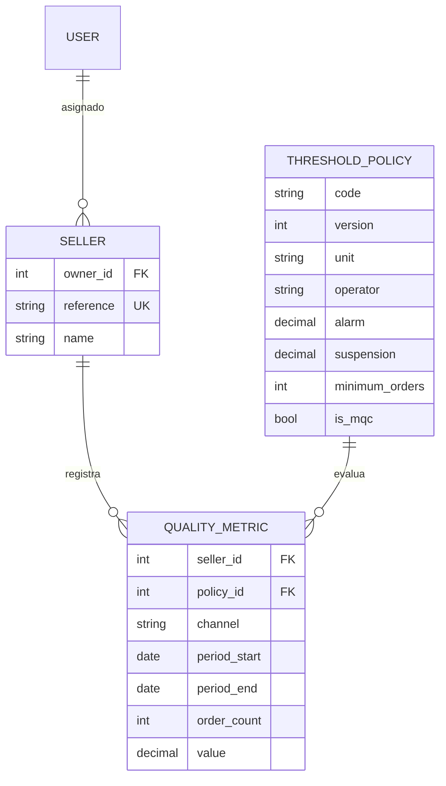

# Arquitectura de SAP

## Decisiones de esta base

Monolito Django con API REST y React compilable como archivos estáticos. Mantener sesiones y servidor bajo un mismo origen reduce la configuración de cookies, CORS y despliegue. Vite se usa como herramienta de frontend; no sustituye Django.

Las aplicaciones `sellers` y `quality` corresponden a conceptos ya implementados. No se crean aplicaciones vacías para planes o usuarios. Se utiliza `auth.User`: los grupos nativos bastan para los roles actuales y no hay requisitos que justifiquen un modelo de usuario propio.

SQLite permite arrancar y probar sin servicios. PostgreSQL se exige cuando `DEBUG=False`, porque una función de Vercel no debe persistir datos en SQLite local. El driver está instalado; no se ha verificado una instancia PostgreSQL real.

## Modelo existente

El formato de observaciones permite añadir periodos y nuevas políticas sin incorporar una columna por cada umbral. Los decimales evitan errores binarios al comparar 98, 98,99 o 20 horas. NPS admite valores negativos hasta −100; el resto de porcentajes está entre 0 y 100. Los tiempos admiten cero y valores positivos.

`code + version` identifica una política. Una política utilizada no puede editarse mediante `save()` ni Django Admin: se crea una nueva versión y las observaciones existentes conservan su FK. `PROTECT` mantiene sus referencias. La unicidad de observaciones con una misma política y la coherencia de fechas tienen restricciones de base de datos; la validación de modelo impide además duplicar el mismo indicador usando otra versión.

Esta última validación entre versiones y los rangos dependientes de la política son controles de aplicación: `QuerySet.update()`, `bulk_create()` y SQL directo no ejecutan `full_clean()`. No deben usarse para importar observaciones ni actualizar políticas. Antes de añadir importaciones concurrentes habrá que reforzar la unicidad por código en el esquema/transacción y normalizar un periodo común si se necesita evitar la repetición de `order_count`. No hay importaciones ni escritura pública de métricas en esta base.

## Acceso y límites de confianza

`IsMarketplaceAgent` controla el rol en la API. `visible_sellers()` limita las consultas del agente a `owner=user`, también en detalles, métricas y escrituras. La creación API asigna el propietario en el servidor. Reasignar vendedores requiere superusuario desde Admin. Los modelos de dominio del administrador están reservados a superusuarios, incluso si se conceden permisos de modelo a otro usuario staff.

No hay cuentas de vendedor en el MVP. Un agente puede crear vendedores propios; no puede cambiar el propietario por JSON. El borrado con indicadores devuelve `409`. La eliminación y reasignación tendrán que revisarse al incorporar los planes y su histórico.

## React y plantillas

El portal `/` y el acceso son HTML renderizado por Django. El panel contiene dos secciones React: vendedores e indicadores. Fetch sigue toda la paginación de la API manteniendo rutas del mismo origen, presenta carga, vacío y error, y cancela las peticiones al cambiar de sección. No se interpreta HTML procedente de la API.

`vite build` genera `frontend/dist/index.html` y recursos bajo `/static/react/`. Django renderiza el índice en `/dashboard/`; los recursos se recogen con `collectstatic`. WhiteNoise usa almacenamiento comprimido sin segundo renombrado: Vite ya incorpora hashes en los nombres y el índice generado conserva esas referencias. No debe configurarse un fallback SPA que capture `/api/`, `/accounts/` o `/admin/`.

## Diseño futuro, todavía sin modelos ni migraciones

| Entidad | Relaciones y validaciones propuestas |
| --- | --- |
| `ActionPlan` | FK vendedor y responsable; problema, causa raíz, objetivo medible, fechas y estado |
| `ActionItem` | FK plan y responsable; compromiso concreto, fecha objetivo, estado y evidencia |
| `FollowUp` | FK plan y autor; fecha, resultado, observaciones y vínculo con nuevas métricas |

Crear `action_plans` cuando empiece esta fase. Los permisos deben derivarse del vendedor del plan y extenderse a acciones y seguimientos. Las transiciones de estado deben validarse en un servicio común con pruebas; no basta con una lista de opciones en React. No se añaden colas ni microservicios.
