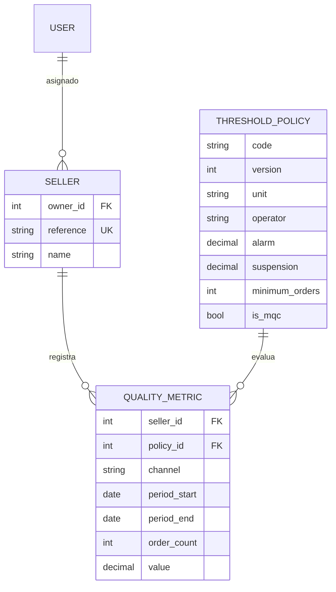

# Arquitectura de SAP

## Decisiones de esta base

Monolito Django con API REST y React compilable como archivos estáticos. Mantener sesiones y servidor bajo un mismo origen reduce la configuración de cookies, CORS y despliegue. Vite se usa como herramienta de frontend; no sustituye Django.

Las aplicaciones `sellers`, `quality` y `action_plans` separan vendedores, métricas y gestión de mejora. La Fase 1 incorpora modelos efectivos de planes, objetivos, acciones y revisiones. Se utiliza `auth.User`: los grupos nativos bastan para los roles actuales y no hay requisitos que justifiquen un modelo de usuario propio.

SQLite permite arrancar y probar sin servicios. PostgreSQL se exige cuando `DEBUG=False`: el disco efímero de la web no debe almacenar la base. La Fase 3 verifica PostgreSQL 14.24 local y propone PostgreSQL 16 gestionado en Render; todavía no hay instancia remota verificada.

## Modelo existente

El formato de observaciones permite añadir periodos y nuevas políticas sin incorporar una columna por cada umbral. Los decimales evitan errores binarios al comparar 98, 98,99 o 20 horas. NPS admite valores negativos hasta −100; el resto de porcentajes está entre 0 y 100. Los tiempos admiten cero y valores positivos.

`code + version` identifica una política. Una política utilizada no puede editarse mediante `save()` ni Django Admin: se crea una nueva versión y las observaciones existentes conservan su FK. `PROTECT` mantiene sus referencias. La unicidad de observaciones con una misma política y la coherencia de fechas tienen restricciones de base de datos; la validación de modelo impide además duplicar el mismo indicador usando otra versión.

Esta última validación entre versiones y los rangos dependientes de la política son controles de aplicación: `QuerySet.update()`, `bulk_create()` y SQL directo no ejecutan `full_clean()`. No deben usarse para importar observaciones ni actualizar políticas. Antes de añadir importaciones concurrentes habrá que reforzar la unicidad por código en el esquema/transacción y normalizar un periodo común si se necesita evitar la repetición de `order_count`. No hay importaciones ni escritura pública de métricas en esta base.

## Acceso y límites de confianza

`IsMarketplaceAgent` controla el rol en la API. `visible_sellers()` limita las consultas del agente a `owner=user`, también en detalles, métricas y escrituras. La creación API asigna el propietario en el servidor. Reasignar vendedores requiere superusuario desde Admin. La administración de vendedores, políticas e indicadores permanece reservada a superusuarios. El Admin de planes permite agentes con grupo, `is_staff` y permisos Django explícitos; sus listados, detalles, referencias y escrituras se limitan a los vendedores accesibles.

No hay cuentas de vendedor en el MVP. Un agente puede crear vendedores propios; no puede cambiar el propietario por JSON. El borrado con indicadores o planes devuelve `409`. Los planes no cambian de vendedor; una reasignación administrativa de un vendedor transfiere el acceso a su histórico y conserva sus autores.

## React y plantillas

El portal `/` y el acceso son HTML renderizado por Django. La Fase 2 incorpora dashboard, directorio y ficha de vendedores, planes, acciones, revisiones y cierre. Fetch solicita páginas de API del mismo origen, presenta carga, vacío y error y cancela peticiones al cambiar de sección. No se interpreta HTML procedente de la API.

`vite build` genera `frontend/dist/index.html` y recursos bajo `/static/react/`. Django renderiza el índice en `/dashboard/`; los recursos se recogen con `collectstatic`. WhiteNoise usa almacenamiento comprimido sin segundo renombrado: Vite ya incorpora hashes en los nombres y el índice generado conserva esas referencias. No debe configurarse un fallback SPA que capture `/api/`, `/accounts/` o `/admin/`.

## Gestión de planes implementada en Fase 1

`ImprovementPlan` tiene FK a vendedor, autor y responsable. `PlanMetric` relaciona cada plan con una observación `QualityMetric` inicial y un objetivo decimal. `PlanAction` conserva compromisos y evidencias. `PlanReview` registra mediciones sucesivas y deriva indicador, unidad y canal de la observación inicial protegida.

Los modelos validan fechas, relaciones, transiciones, rangos y conservación del histórico. `services.py` calcula resultados sin cambiar el estado administrativo y proporciona el cierre autorizado y transaccional con una instantánea de evaluación. Las consultas de detalle usan `select_related` y `prefetch_related`; hay una prueba que verifica el número de consultas al evaluar un plan con histórico.

La migración `action_plans/0001_initial.py` es aditiva: crea cuatro tablas con FK protegidas, índices y restricciones, sin alterar datos anteriores. Los permisos de agente se asignan expresamente mediante `configure_plan_agent`; la migración no habilita usuarios automáticamente.

El [documento de Fase 1](fase-1.md) contiene diagrama, estados, matriz de permisos, pasos de Admin, demo, decisiones sobre ventanas de medición y límites de integridad. La Fase 2 añade API y formularios React reutilizando estas reglas. La Fase 3 mantiene el monolito y añade las garantías de producción descritas a continuación.

## Producción e integridad de Fase 3

Render HTTPS → Gunicorn WSGI (dos workers) → Django/WhiteNoise → PostgreSQL por TLS. `scripts/build.sh` construye React y estáticos; `scripts/release.sh` migra una vez antes del arranque. No hay migraciones por worker, contenedores obligatorios ni datos en el disco de la web. `/healthz/` comprueba SQL y devuelve 503 ante indisponibilidad, sin detalles internos.

Las escrituras HTTP bloquean el vendedor autorizado y después el plan. Los hijos y el cierre comparten bloqueo del plan; las revisiones distintas son append-only. `revision` detecta ediciones obsoletas en React/Admin y `save()`. `request_key` y `request_hash` deduplican creaciones de planes/acciones bajo una transacción y una restricción única. El cliente conserva la clave al reintentar el mismo payload. Los clientes antiguos sin revisión/cabecera mantienen el contrato anterior; no reciben esas garantías adicionales de detección/deduplicación.

Django-axes persiste el bloqueo temporal de login en PostgreSQL y no requiere Redis. Las sesiones caducan a las ocho horas. La confianza de proxy se activa expresamente, con hosts/orígenes exactos. Se justifica sólo la excepción `axes.W006`, comprobando que cambiar cookies/User-Agent no evita el bloqueo global por usuario. El resto de avisos Django permanece activo.

La migración aditiva `0002_concurrency_guards` conserva las anteriores. Se comprobó migración vacía, carrera de cierres/revisiones/ediciones/creaciones, reinicios y restauración aislada; no se han comprobado despliegue ni recuperación remotos. Detalles en [Fase 3](fase-3.md) y [operación](despliegue.md).
