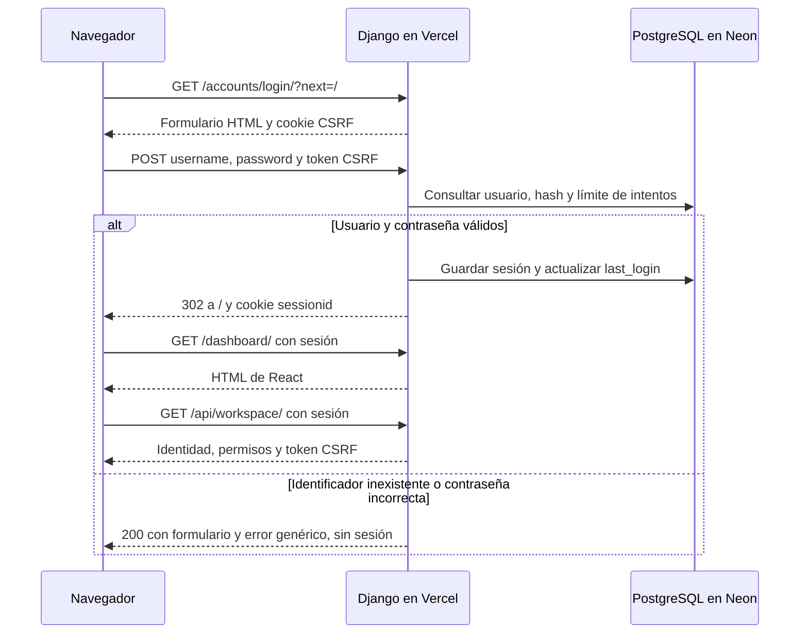

# Diagnóstico del acceso de SAP — 04/11/2026

## Resultado y acceso inmediato

**Causa confirmada: el identificador utilizado por el titular no pertenece a ninguna cuenta de producción.** El formulario espera `auth.User.username`. El correo comunicado por el titular no existe ni como `username` ni como `email` en Neon. No se reproduce un fallo técnico del login: las dos cuentas de evaluación existentes se autentican por HTTPS y pueden utilizar la aplicación desplegada.

Para acceder ahora, utilizar la cuenta **`evaluador`** en <https://sap-bice.vercel.app/accounts/login/> con su contraseña de evaluación. El titular dispone de esa contraseña en el apartado `evaluador` del archivo local privado `artifacts/private/sap-production-access.json`, ignorado por Git y con permisos 0600 dentro de un directorio 0700. No publicar ese archivo ni copiar su contenido en informes. Su contraseña se ha utilizado en memoria para la comprobación, sin imprimirla ni modificarla.

El acceso con el correo personal sigue requiriendo un alta autorizada si el titular quiere una cuenta adicional. No se ha creado esa cuenta ni cambiado ninguna contraseña. No hace falta desplegar código para utilizar la cuenta existente.

## Auditoría de arquitectura y configuración

Se revisaron la estructura completa de fuentes y documentación, manifiestos y dependencias, configuración Django, plantillas, entrada React, servicio HTTP, vistas y permisos, modelos y migraciones, comandos de usuarios/demos, scripts de build/verificación y configuración de CI/despliegue. No se modificaron archivos hasta confirmar la ausencia del usuario y completar una prueba HTTP autenticada en producción.

| Parte | Implementación y archivos relevantes |
| --- | --- |
| Servidor | Django 5.2.18, Django REST Framework 3.18.3; `backend/config/settings.py`, `urls.py`, `views.py`, `wsgi.py` |
| Login | `django.contrib.auth.views.LoginView`, `AuthenticationForm`, `ModelBackend` y usuario nativo; `backend/templates/registration/login.html` |
| Protección de intentos | django-axes 8.3.1, intentos persistidos en PostgreSQL, límite de 5 fallos por nombre de usuario y enfriamiento de 15 minutos |
| Sesiones y CSRF | Middleware nativo, sesión en `django_session`, cookie `sessionid` y token CSRF; logout exclusivamente POST |
| Interfaz | React 19.3.1, Vite 7.3.7, Node 22; `frontend/src/main.jsx`, `services/api.js`, `vite.config.js` |
| Autorización | Grupo `Marketplace Agent`, permisos de operación y filtro por propietario; `sellers/models.py`, `permissions.py`, vistas de `action_plans` y `quality` |
| Datos | PostgreSQL 18.6 en Neon, psycopg 3.3.6, conexión pooled TLS; conexión directa disponible para administración |
| Producción | Vercel, preset Django y función WSGI en Frankfurt; raíz `backend`, fuentes externas a la raíz habilitadas y estáticos en CDN |
| Build | `backend/build_vercel.py` compila React, copia `frontend_dist` y ejecuta checks; el preset publica estáticos; no migra ni crea usuarios |
| Datos iniciales | `create_demo_agent` solicita contraseña privada, valida y aplica hash; rechaza usuarios existentes. Los comandos de demo requieren activación explícita y no se ejecutan al arrancar |
| Configuraciones alternativas | `render.yaml`, Gunicorn y `scripts/release.sh` corresponden a la receta Render. No gobiernan el despliegue activo en Vercel |
| CI y verificación | `.github/workflows/ci.yml`, tests Django/frontend, `scripts/check_production.py`, `scripts/verify_vercel.py` y verificadores de navegador |

Flujo comprobado:

`next=/` lleva al portal HTML; su enlace «Abrir dashboard» carga React. Sin `next`, el destino es `/dashboard/`. React consume rutas relativas del mismo origen mediante `credentials: "same-origin"`; el login no es una petición JSON de React. Las escrituras y el logout utilizan el token CSRF. No se necesita añadir CORS para este diseño.

| Diferencia | Desarrollo inspeccionado | Producción comprobada |
| --- | --- | --- |
| Variables | Django lee `.env`; `DJANGO_DEBUG=True`, hosts localhost y orígenes Vite | Vercel excluye `.env` y recibe variables de Production; configuración segura validada por el código y comportamiento HTTPS |
| Base actual de `.env` | Ya apunta a Neon pooled; no es una base de pruebas aislada | PostgreSQL persistente, 33 migraciones aplicadas, ninguna pendiente |
| SQLite anterior | Existe `backend/db.sqlite3` con una cuenta administrativa local | No se copia ni se usa esa base; hay dos cuentas de evaluación sin privilegios administrativos |
| Cookies | Sin `Secure` en modo debug para permitir HTTP local | `sessionid`: Secure, HttpOnly, SameSite=Lax; CSRF: Secure, SameSite=Lax |
| Frontend | Vite permite proxy `/api` y `/accounts` hacia Django | React compilado bajo `/static/react/assets/`, mismo dominio para sesión y API |
| Proxy y TLS | Sin confianza en proxy en `.env` local | `X-Forwarded-Proto` reconocido en Vercel; HTTPS y HSTS observados |

Las pruebas locales forzaron una base aislada mediante `DATABASE_URL`; ejecutar tests con el `.env` sin revisar su destino sería inadecuado porque actualmente apunta a Neon.

## Evidencias de la causa raíz

1. El titular confirmó la URL `/accounts/login/?next=/`, el correo utilizado y un error de credenciales incorrectas. Se omite su correo en este documento por privacidad.
2. Consulta SQL/ORM con `SET TRANSACTION READ ONLY`: solo existen `evaluador` y `otro_agente`, ambos activos, con grupo `Marketplace Agent`, sin `is_staff` ni `is_superuser`. El identificador comunicado no coincide con ningún `username` ni `email`.
3. Axes conserva un intento fallido para ese identificador. La comprobación final encontró 1 fallo, por debajo del límite de bloqueo. No se eliminó ni se reinició ese registro.
4. Ambos usuarios existentes tienen hash `pbkdf2_sha256`; la verificación del hash con la credencial privada guardada devuelve verdadero. No se invocó ningún cambio de contraseña.
5. Login real con esas cuentas: sesión válida, identidad correcta en `/api/workspace/` y navegación funcional. Sus `last_login` en la base consultada coinciden con las pruebas del navegador y no quedan intentos fallidos para esas cuentas tras el éxito.
6. Un identificador inexistente y una contraseña incorrecta devuelven el error genérico del formulario sin sesión. Es una respuesta HTML HTTP 200 esperada, no un fallo 5xx ni una excepción de React.

La cuenta local de SQLite no demuestra que exista en PostgreSQL. Tampoco se crean cuentas SAP por tener un correo o una cuenta del proveedor. No se ha encontrado evidencia que justifique modificar CORS, CSRF, hashes, cookies, hosts o la URL de la API para solucionar este caso.

## Despliegue realmente observado

Lectura de API/CLI y logs de Vercel el 04/11/2026:

- Alias: `sap-bice.vercel.app`.
- Deployment: `dpl_f2TT2cSumwaoD73Bc585kJcohJV7`, estado `READY`, entorno `production`.
- URL inmutable: `sap-k8rieqnj3-pablo-s-coding.vercel.app`.
- SHA: `d195b1c787d41a2ecb47f6575d3624ac503181d9`.
- Raíz `backend`, framework `django`, Node `22.x`, build `python build_vercel.py`.
- Variables Production presentes: `DATABASE_URL`, `DJANGO_ALLOWED_HOSTS`, `DJANGO_CSRF_TRUSTED_ORIGINS`, `DJANGO_DEBUG`, `DJANGO_SECRET_KEY`, `SAP_DEMO_MODE`; sus valores no se incluyen en evidencias.

Este es un despliegue posterior al del acta del 03/11. La comprobación actual utiliza el alias y deployment realmente activos. La lectura inicial directa de API recibió 403 con la sesión almacenada anterior; la CLI autenticada funcionó y la lectura final de API también. No fue una respuesta del login de SAP.

El resumen final de logs contiene 50 registros de la última hora, todos del deployment indicado: 0 respuestas 5xx; login con respuestas 200 y 302. Es una muestra limitada, no una afirmación sobre todo el historial. Las comprobaciones HTTP y del navegador acreditan las rutas/estáticos usados. En una lectura anterior aparecieron un aviso de WhiteNoise sobre el directorio estático de la función y un 404 de favicon; los JS/CSS servidos por CDN devolvieron 200 y no impidieron autenticar. No se cambiaron esos aspectos ajenos a la causa.

## Corrección aplicada y archivos

Se corrigió la indicación operativa de acceso: usar una cuenta SAP que ya existe y la contraseña asignada. Se preserva la autenticación que supera las pruebas. No se añade autenticación por correo ni se sustituye el sistema por Neon Auth.

- `README.md`: aclara el uso de nombre de usuario y la separación entre cuentas locales y productivas; enlaza este diagnóstico.
- `backend/config/test_authentication.py`: dos regresiones con CSRF real y proxy HTTPS. Una reproduce correo de contacto/identidad inexistente/contraseña errónea y comprueba error genérico, ausencia de sesión y posterior éxito con username. La otra verifica `next=/`, reutilización de sesión desde otro cliente y revocación de la cookie anterior tras logout.
- Este informe y `docs/evidencias-login-2026-11-04.json`: diagnóstico y resultados sin secretos.

No se modificaron vistas, modelos, permisos, configuración de seguridad ni lógica de negocio. No hacen falta migraciones, variables nuevas, commits ni despliegues para entrar con la cuenta existente.

## Pruebas ejecutadas

| Entorno | Prueba | Resultado |
| --- | --- | --- |
| Local, SQLite en memoria | Suite Django completa desde `backend`, con `DATABASE_URL=''` y `DJANGO_DEBUG=True` | 114 pruebas; OK, 9 omitidas por requerir PostgreSQL |
| Local, PostgreSQL 14.24 temporal | Migraciones, `migrate --check`, `makemigrations --check --dry-run` y suite Django | 114 pruebas; OK sin omisiones; servidor temporal detenido y eliminado al terminar |
| Local, proxy HTTPS simulado | Dos regresiones nuevas de identidad/sesión | Ambas aprobadas; también incluidas en las suites completas |
| Local, Node 22 | `npm test` y `npm run build` | Aprobados; 33 módulos React compilados |
| Local | `manage.py check`, `scripts/check_production.py` y `pip check` | Aprobados; el check estático productivo usa datos ficticios y no prueba conectividad |
| Local, paquete Vercel aislado | `scripts/verify_vercel.py` | Build correcto, 157 estáticos, WSGI/plantillas/rutas/hosts/HTTPS comprobados sin PostgreSQL remoto |
| Producción, HTTPS real | Login válido e inválido, CSRF ausente/origen ajeno, cookies, dashboard, APIs, logout | Login válido 302; usuario desconocido 200 con error sin sesión; CSRF inválido 403; autenticado 200; logout GET 405, POST válido 302, API posterior 403 |
| Producción, Chromium | Ambas cuentas, formulario real `?next=/`, portal, React, vendedores/planes, recarga, nuevo contexto y logout | Aprobado en ambas; cookie antigua rechazada; 0 errores JS y 0 respuestas 5xx/errores de assets en ese recorrido |
| Producción, Neon | SQL de solo lectura, hash, estado/grupos, migraciones y `last_login` | PostgreSQL 18.6 con TLS, 33 migraciones, 0 pendientes, ambas cuentas válidas |

Los logs detallados locales y los JSON del navegador, PostgreSQL y lectura externa están en `artifacts/login-audit-2026-11-04/` (ignorado por Git). El resumen versionable no contiene contraseñas, hashes, tokens, cookies ni URLs privadas de conexión.

Durante la preparación, la primera invocación de la suite desde la raíz descubrió 0 tests; se descartó y se repitió desde `backend`, con los resultados completos indicados. Un primer comprobador de navegador falló por importar incorrectamente `expect`; se corrigió el comprobador temporal y se completó el recorrido. El aislamiento inicial impidió abrir Chromium, sockets PostgreSQL y conexiones externas; se repitieron esas operaciones con los permisos concedidos. Esos incidentes del entorno de comprobación no se atribuyen al producto.

## Estado final y límites

**Autenticación verificada en producción con las cuentas existentes.** Para el titular, la acción inmediata es entrar como `evaluador` usando su contraseña privada de evaluación. El identificador personal continúa sin alta; no se afirma que ese correo pueda iniciar sesión.

No se hicieron commits, push, despliegues, migraciones externas, altas de usuarios ni cambios de contraseña, roles o datos de negocio. Las únicas escrituras productivas son las normales del login/logout y sus intentos: sesiones, `last_login` y Axes. Se cerraron las sesiones de prueba.

La suite completa usa PostgreSQL 14 local; el recorrido público usa PostgreSQL 18.6. No se ejecutó la suite destructiva de tests contra Neon ni se repitieron en producción las escrituras de planes y cierres. No se redesplegó para probar persistencia entre despliegues en esta intervención; sí se comprobó persistencia entre peticiones, recarga y contextos de navegador. Tampoco se ha confirmado aún un inicio de sesión manual del titular ni una segunda red independiente.
