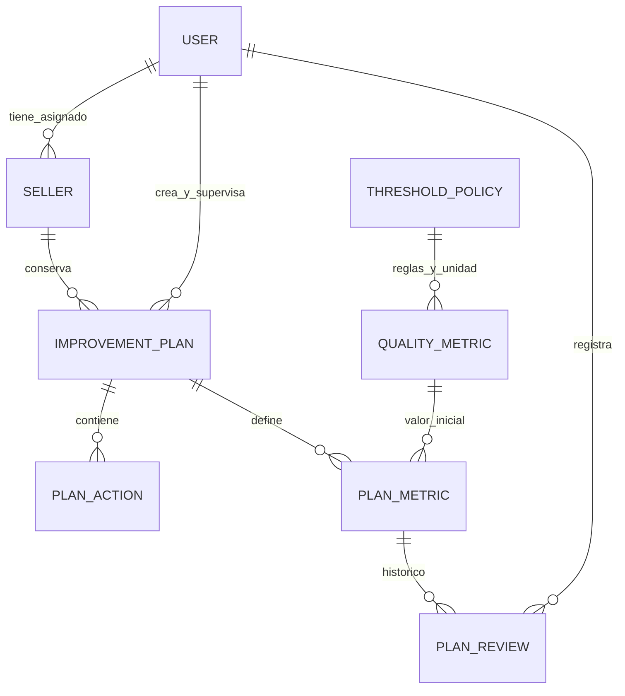

# Fase 1: gestión de planes de mejora

Implementada el 23/10/2026 sobre la base existente. El alcance de esta fase termina en Django Admin: no incorpora un nuevo frontend de planes ni una API de escritura de planes. Las dos secciones React siguen consultando vendedores e indicadores reales.

## Auditoría y decisiones

La base tenía `Seller.owner`, el grupo `Marketplace Agent`, autenticación por sesión, aislamiento por vendedor, observaciones `QualityMetric`, políticas `ThresholdPolicy`, Django Admin reservado a superusuarios y 18 pruebas Django. Se comprobaron esas 18 pruebas antes de modificar los modelos. Se conservan las apps y los controles existentes; se añade `action_plans` porque el concepto de plan todavía no tenía modelos implementados.

Los archivos de documentación en español y los cambios previos del README ya estaban en el árbol de trabajo. Se mantienen esos cambios. La revisión del 22/10 es un documento histórico; su diagnóstico de planes pendientes corresponde a la versión anterior.

## Modelos y relaciones



| Modelo | Datos y reglas principales |
| --- | --- |
| `ImprovementPlan` | ID, vendedor, título, problema, periodo, causa raíz, evidencia, objetivo descriptivo, autor, responsable, creación, plazo, próxima revisión y estado. El cierre registra fecha, razones y evaluación medida |
| `PlanMetric` | Relaciona el plan con una observación inicial existente y un objetivo decimal. Permite varios indicadores y canales; el periodo y el vendedor deben coincidir con el plan |
| `PlanAction` | Acción correctiva o preventiva, descripción, persona/equipo, fecha límite, estado, finalización, observaciones y evidencia textual |
| `PlanReview` | Objetivo evaluado, fecha de revisión, autor y fecha de registro, valor observado opcional, periodo, volumen de pedidos opcional, comentarios, valoración del agente y próximos pasos |

La revisión deriva indicador, canal y unidad de `PlanMetric.baseline.policy`. No vuelve a pedirlos al usuario: esas referencias quedan protegidas contra edición y borrado. Sus valores se guardan en la revisión como observaciones propias del seguimiento del plan, sin añadir observaciones globales duplicadas en `QualityMetric` ni abrir la administración de políticas a los agentes. El clasificador y los validadores se reutilizan para ambos tipos de observación.

Todas las FK de histórico usan `PROTECT`. Hay restricciones SQL para periodos, estados, coherencia de finalización de acciones y planes, y unicidad de objetivo por observación y revisión por objetivo/periodo. La validación de aplicación impide además duplicar un indicador/canal en un plan, incluso usando otra observación o versión de política.

## Estados y resultado

Un plan nace en **borrador**. Para pasar a **en progreso** necesita al menos un objetivo y una acción. Desde progreso puede pasar a **en revisión**, y volver a progreso. Desde progreso o revisión se puede **cerrar**; desde cualquier estado abierto se puede **cancelar** documentando las razones. Un borrador debe activarse antes de cerrarse; puede cancelarse directamente. Los estados finales no se reabren ni se editan desde Admin. Un nuevo ciclo de mejora se registra como otro plan del vendedor.

La acción admite pendiente, en progreso, completada y cancelada. Completar requiere fecha válida y evidencia de ejecución; una acción finalizada no puede volver a un estado abierto. Vencida significa fecha anterior al día local de Madrid y estado pendiente o en progreso; el día del plazo todavía no está vencida. Los plazos del plan deben incluir los de sus acciones.

El resultado medido se calcula aparte: `achieved`, `not_achieved` o `not_evaluable`. El objetivo se alcanza con `actual <= objetivo` en incidencias y tiempos, y con `actual >= objetivo` en aceptación, seguimiento, NPS y entrega. La mejora respecto al inicio es estricta. La última revisión se elige por fin del periodo medido, fecha de revisión e ID; una carga tardía de un periodo anterior no sustituye al resultado actual.

Sin revisión o con datos insuficientes no se deduce éxito ni fracaso. Una revisión reciente sin datos no hace reaparecer un resultado favorable anterior. En planes con varios indicadores, todos deben ser evaluables y alcanzar el objetivo para declarar éxito global. La valoración escrita por el agente no reemplaza el cálculo.

`close_plan()` exige permisos, vendedor accesible y razones. Bloquea el plan en una transacción y guarda una instantánea JSON con valores iniciales, objetivos, valores actuales, identificadores de revisión, periodos, resultados y recuentos de acciones. Las escrituras de acciones, objetivos y revisiones usan el mismo bloqueo del plan. Es posible cerrar con objetivos incumplidos, sin mediciones o con acciones pendientes, siempre explicando la decisión. El cierre no completa acciones ni cambia datos de Mirakl.

El responsable del seguimiento es un dato operativo. **El acceso deriva de la asignación del vendedor**, y no de ese campo. Si un administrador reasigna el vendedor, su nuevo agente recibe acceso al histórico; los autores de los registros se conservan.

## Métricas y condiciones de evaluación

Se consultaron las tres referencias oficiales el 23/10/2026: [criterios MQC](https://marketplacehelp.pccomponentes.com/hc/es-es/articles/20561228339357-criterios-de-calidad-automatizados), [preparación de planes](https://marketplacehelp.pccomponentes.com/hc/es-es/articles/38119386983965-como-mejorar-tus-indicadores-de-calidad-y-preparar-un-plan-de-accion) y [NPS y entrega](https://marketplacehelp.pccomponentes.com/hc/es-es/articles/37487009483805-NPS-y-eficiencia-de-entrega).

Los umbrales oficiales existentes se mantienen, centralizados para las cargas iniciales en `quality/rules.py` y versionados en `ThresholdPolicy`. Se corrigió una carencia del clasificador original: antes comprobaba pedidos, pero no duración del periodo. Ahora MQC exige valor, volumen conocido suficiente y periodo mensual. `not_evaluable` indica ausencia de datos o periodo inadecuado; `insufficient_orders` conserva el significado existente de volumen inferior al mínimo.

Convención explícita de SAP para el registro manual: mes natural o ventana móvil de un mes, extremos incluidos, desde el día de inicio hasta el día anterior a la misma fecha del mes siguiente, ajustando al último día si no existe esa fecha. La fuente dice «último mes», pero no especifica ese algoritmo de extremos; la convención es una decisión local, pendiente de contrastar si se incorpora una integración. La evaluación corresponde al periodo registrado, aunque sea histórico, y no representa la situación actual del vendedor. No se agregan pedidos ni se certifica la procedencia de un valor manual.

Las revisiones semanales pueden guardarse con comentarios y valores, pero MQC y el objetivo asociado quedan no evaluables si no incluyen una ventana mensual y al menos los pedidos exigidos por la política. NPS y entrega mantienen su evaluación independiente, sin suspensión y sin aplicarles el mínimo MQC de pedidos. React reconoce el nuevo estado no evaluable.

## Migración e instalación

Desde la raíz, con las dependencias existentes instaladas:

```bash
cd backend
../.venv/bin/python manage.py migrate
../.venv/bin/python manage.py configure_plan_agent --username TU_USUARIO
```

Con un entorno activado, o en Windows, se puede usar `python` en lugar de `../.venv/bin/python`. El usuario debe existir y estar activo; no se crean contraseñas. `configure_plan_agent` añade el grupo existente, permisos individuales `add/change/view` de planes, objetivos y acciones, `add/view` de revisiones y el permiso específico de cierre. Habilita `is_staff` para acceder a Admin. No concede permisos administrativos de vendedores, políticas ni usuarios, ni convierte al agente en superusuario. El comando es idempotente y está pensado para una terminal administrativa confiable. `is_staff` por sí solo no basta.

`action_plans/0001_initial.py` crea exclusivamente tablas, índices, restricciones y el permiso de cierre del módulo. Depende de las migraciones iniciales de vendedores, calidad y del usuario configurado. No modifica ni elimina registros anteriores, ni asigna privilegios a usuarios automáticamente. Django crea los permisos tras `migrate`. La migración se aplicó correctamente a la SQLite local y también se ejecuta desde cero en cada suite de test. No hay nuevas dependencias.

## Recorrido manual por Django Admin

1. Un superusuario registra el vendedor ficticio, lo asigna al agente y añade una observación inicial de incidencias del 6%, canal y mes de referencia, con al menos 30 pedidos. Puede usarse una cuenta existente configurada con el comando anterior.
2. El agente entra en `/admin/` y crea un borrador en **Planes de mejora**, con diagnóstico, evidencia, periodo coincidente, responsable y plazo.
3. En **Objetivos por indicador**, selecciona ese plan y observación inicial, y fija `3` como objetivo. La unidad se conserva desde el indicador.
4. En **Acciones del plan**, crea al menos dos acciones con equipo y fechas dentro del plazo del plan. Una puede ser correctiva y otra preventiva.
5. Cambia el plan a **En progreso**. Completa una acción indicando fecha y evidencia.
6. En **Revisiones del plan**, añade una medición mensual de `4.5` y después otra de `3`, con periodos posteriores al inicial, pedidos, comentarios y valoración. Las fechas de revisión deben ser posteriores o iguales al fin de la medición y no futuras.
7. La ficha del plan muestra **inicial → objetivo → actual**, mejora, logro y recuentos de acciones. Los enlaces de la ficha permiten consultar objetivos, acciones e histórico de revisiones del plan. También hay búsqueda y filtros de estado y acciones vencidas.
8. Usa **Cerrar o cancelar con resultado**, introduce las razones y confirma. La ficha permanece consultable, con la evaluación del cierre y su histórico.

Se utiliza el punto decimal en los comandos; en formularios HTML puede escribirse según la configuración regional del navegador. Los ejemplos de periodos julio, agosto y septiembre de 2026 permiten reproducir el caso desde la fecha de esta fase.

## Demostración reproducible

```bash
# Desde backend/, con entorno activado y un usuario existente autorizado
python manage.py seed_plan_demo --owner TU_USUARIO
```

Solo funciona con `DEBUG=True`. Crea `Tienda Ficticia Envíos` (`SAP-DEMO-PLAN`), incidencias iniciales del 6% en julio de 2026, dos acciones, una completada, revisiones de agosto (4,5%) y septiembre (3%) y cierre con resultado alcanzado. Conserva expresamente una acción preventiva pendiente para demostrar que ejecución y resultado son independientes. Es idempotente y rechaza reutilizar datos asignados a otro usuario. No crea usuarios, contraseñas ni mensajes externos. La demo original `seed_demo` sigue disponible sin alterar sus dos vendedores y catorce observaciones.

`test_full_acceptance_flow_through_admin_forms` demuestra además la creación y actualización por peticiones HTTP del cliente de pruebas Django, incluida la autoría impuesta por el servidor y el rechazo de edición del histórico. La suite incluye una prueba de cierre con CSRF exigido.

## Verificación ejecutada el 23/10/2026

| Comprobación | Resultado observado |
| --- | --- |
| Suite original antes de cambios | 18 pruebas Django aprobadas |
| Suite final `manage.py test --verbosity 2` | 46 pruebas Django aprobadas, incluidas las 18 originales |
| `manage.py migrate --noinput` | Migración de planes aplicada correctamente a SQLite local |
| `manage.py check` | Sin incidencias |
| `makemigrations --check --dry-run` y `migrate --check` | Sin cambios de modelo ni migraciones pendientes |
| `pip check` | Sin dependencias incompatibles; aviso del entorno sobre caché pip no escribible |
| `npm test` | Correcto con Node 22.19.0; también se ejecutaron explícitamente los dos casos Fetch con aislamiento desactivado |
| `npm run build` | Compilación Vite correcta con Node 22.19.0 |
| `collectstatic --noinput` | Correcto; frontend y administrador recogidos |
| `scripts/check_production.py` | Sin incidencias con variables ficticias; no conecta a PostgreSQL |
| Demo en SQLite temporal | Comandos de configuración y carga ejecutados; repetición idempotente y reconexión confirman plan cerrado, dos acciones y dos revisiones persistidas |
| `git diff --check` | Sin errores de espacios en los cambios versionados |

El runner habitual resume el archivo JavaScript como una unidad. Para comprobar por separado ambos casos se ejecutó `node --test --experimental-test-isolation=none --test-reporter=spec src/services/api.test.js` desde `frontend/`, con resultado 2/2.

La base temporal de la demostración se eliminó al terminar. No se modificaron cuentas ni asignaciones de agentes de la base local mediante los comandos de demostración. Durante esa validación inicial no se hizo commit ni push. Las incidencias de ejecución y la aserción corregida están registradas en [verificacion.md](verificacion.md).

## Conservación del hito en Git

La implementación de Fase 1, su migración, pruebas, demo y este informe se guardan en un commit local significativo, posterior al commit de la base funcional. También se incluyen los renombrados de documentación al español y sus enlaces actualizados. El informe conserva las decisiones arquitectónicas, las evidencias de verificación y las limitaciones para utilizarlas en la futura memoria técnica. El push requiere confirmación expresa; crear el commit local no publica cambios en GitHub ni acredita la ejecución remota de CI.

## Límites y siguiente fase

La integridad que depende de otras tablas y la inmutabilidad del histórico se validan en `full_clean()`/`save()`, formularios y servicios. `QuerySet.update()`, `bulk_create()` y SQL directo pueden eludir esas comprobaciones y quedan fuera de las rutas de escritura soportadas. Las restricciones SQL cubren invariantes locales y FK; no son una auditoría general de administradores con acceso directo a la base. No hay endpoints públicos nuevos para realizar esas operaciones masivas.

Las pruebas se ejecutaron con SQLite. El código solicita bloqueos de fila al cerrar o escribir hijos; SQLite no ofrece la misma semántica que PostgreSQL. La concurrencia real y las migraciones sobre PostgreSQL deben comprobarse antes de la publicación. También siguen pendientes el despliegue público, TLS real, copias/restauración y ejecución remota de CI. No se ha repetido una prueba con navegador real en esta fase.

La Fase 2 debería empezar por una ficha de vendedor en React que consuma una API de planes con estos mismos filtros de acceso, servicios y validaciones, y formularios para acciones, revisiones y cierre. Mantener la comparación tabular y la validación del servidor; no hace falta incorporar gráficas complejas ni Mirakl para completar esa interfaz.
