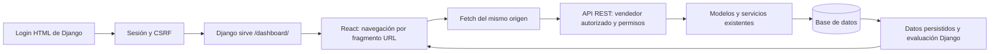

# Fase 2: interfaz operativa de Seller Action Plan

Implementada el 23/10/2026 sobre el repositorio de Fase 1. El agente puede gestionar el ciclo de mejora desde `/dashboard/`, sin entrar en Django Admin. No se ha desplegado en producción ni publicado en GitHub.

## Inspección y objetivo

Se leyeron README, `docs/fase-1.md`, modelos, servicios, permisos, formularios y Admin, APIs y montaje React antes de editar. El árbol de trabajo estaba limpio. La comprobación inicial desde `backend/` aprobó las **46 pruebas Django** existentes y los **2 casos JavaScript**. Ejecutar `manage.py test` desde la raíz no descubrió pruebas; la verificación válida se ejecutó desde `backend/`.

La Fase 1 aportaba toda la lógica del plan, pero no una API ni una interfaz operativa para el agente. Se conservan modelos, migraciones, umbrales, clasificador, transiciones, inmutabilidad del histórico y `close_plan()`. Se amplía el prefetch de históricos para evitar consultas por autor y vendedor al serializar.

## Arquitectura



La navegación usa `#/`, `#/sellers`, `#/sellers/:id`, `#/plans`, `#/plans/new` y `#/plans/:id`. No se añade un router, Redux ni biblioteca de componentes. Los enlaces de fragmento permiten recargar cualquier ficha bajo la vista Django y usar atrás/adelante del navegador. Vite mantiene su proxy para desarrollo.

`/api/workspace/` devuelve el usuario, las capacidades, el día local de Madrid y un token CSRF enmascarado. No expone claves ni contraseñas. Las escrituras incorporan la cookie de sesión y `X-CSRFToken`. Django sigue sirviendo el login, el portal HTML y el administrador. Tras iniciar sesión se abre el dashboard; `/` conserva la plantilla de vendedores.

## Pantallas y componentes

| Archivo | Responsabilidad |
| --- | --- |
| `frontend/src/main.jsx` | Navegación, sesión, cabecera, menú adaptable y cierre de sesión POST |
| `frontend/src/components/ui.jsx` | Campos accesibles, diálogos, mensajes, búsqueda, paginación, formato y hooks de consulta/escritura |
| `frontend/src/pages/Workspace.jsx` | Dashboard, listados, ficha del vendedor e historial |
| `frontend/src/pages/PlanForm.jsx` | Diagnóstico, vendedor contextual, varios indicadores, responsable y plazos; edición del plan |
| `frontend/src/pages/PlanDetail.jsx` | Comparación de objetivos, acciones, revisiones, cambios de estado, objetivos y cierre |
| `frontend/src/services/api.js` | Fetch, CSRF, errores por campo, cancelación de peticiones y rutas del mismo origen |
| `frontend/src/styles.css` | Sistema visual y adaptación a escritorio, tablet y móvil |
| `backend/action_plans/serializers.py` | Entradas autorizadas, creación atómica, representación y errores de dominio |
| `backend/action_plans/views.py` | API de planes, resumen, sesión y responsables |
| `backend/sellers/views.py`, `serializers.py` | Búsqueda, recuentos, planes abiertos, ficha y ausencia de indicadores |
| `backend/quality/views.py` | Filtros por vendedor y última observación por indicador/canal |
| `backend/templates/`, `backend/sellers/static/sap/auth.css` | Login y portal Django con identidad visual coherente |

### Dashboard

Seis contadores reales: vendedores visibles, planes abiertos, acciones pendientes, vencidas, planes por revisar y cerrados. Las acciones pendientes y vencidas se cuentan solo en planes abiertos; una tarea que quedó pendiente en un cierre histórico no vuelve a la cola de trabajo.

Prioridades: acciones con fecha anterior a hoy o con plazo entre hoy y los próximos **7 días**, ambas fechas incluidas. Se muestran hasta diez, con contador total y acceso al conjunto de planes. Una fecha igual a hoy no está vencida. Cada entrada permite abrir la acción dentro de su plan.

Revisiones: estado `in_review` o `next_review_on <= hoy`, excluyendo planes finales. No se inventan fechas. El dashboard incluye hasta cinco planes por revisar, cinco planes recientes y diez observaciones con desviación, siempre con periodo y canal. El contador de vendedores con desviaciones usa la última observación global de cada indicador/canal; una revisión de un plan no modifica las observaciones globales.

### Vendedores

Búsqueda por nombre o referencia, filtro con/sin planes abiertos y paginación del servidor. Ficha con agente, indicadores, valores, volumen, periodo, versión de política, clasificación, indicadores sin datos, planes activos e historial con resultados. El histórico de observaciones puede consultarse sin cargarlo por defecto. El botón contextual utiliza una observación registrada y el vendedor seleccionado; la API vuelve a validar ambas relaciones.

### Planes

Listado paginado con búsqueda por título, vendedor, referencia o responsable; filtro de estado y filtros contextuales por vendedor/revisión. Diagnóstico con evidencia, periodo, causa y objetivo, varios indicadores con sus metas y responsable autorizado. La selección de vendedores, observaciones y responsables está paginada.

Creación atómica de borrador más objetivos: si un indicador falla, no queda un plan incompleto. El usuario añade las acciones y activa el plan. El detalle permite editar diagnóstico y fechas, completar borradores anteriores añadiendo indicadores, editar metas mientras lo permita el modelo, crear/editar acciones, registrar evidencias y fechas de finalización, registrar revisiones y pasar a revisión/en progreso.

Las revisiones muestran periodo, valor, pedidos, autor, comentarios, valoración y próximos pasos. La comparación **inicial → objetivo → último valor** y el resultado proceden de `evaluate_plan()`, incluyendo dirección de mejora y condiciones de evaluación. El cierre pide razones, muestra resultados y tareas pendientes, exige confirmación y usa `close_plan()`. Puede documentarse un cierre insuficiente; completar tareas no implica alcanzar objetivos. Los planes finales son consultables y no editables.

## API

Todos los endpoints requieren sesión y rol Marketplace Agent o superusuario. Las operaciones del módulo requieren además los permisos específicos de Fase 1.

| Ruta | Método | Uso |
| --- | --- | --- |
| `/api/workspace/` | GET | Sesión, capacidades, fecha local y CSRF |
| `/api/overview/` | GET | Contadores y prioridades filtrados por usuario |
| `/api/responsibles/?search=&page=` | GET | Responsables autorizados, 20 por página |
| `/api/sellers/?search=&active_plans=1&page=` | GET | Directorio, 50 por página |
| `/api/sellers/{id}/` | GET | Ficha, responsable y códigos de indicadores sin observaciones |
| `/api/metrics/?seller={id}&latest=1&page=` | GET | Observaciones del vendedor; `latest=1` selecciona la última por código/canal |
| `/api/plans/?search=&status=&seller=&responsible=&review=due&page=` | GET | Planes, 20 por página; `status=open/final` o estado individual |
| `/api/plans/` | POST | Crear plan y uno o varios objetivos en una transacción |
| `/api/plans/{id}/` | GET, PATCH | Detalle y edición; no hay borrado |
| `/api/plans/{id}/metrics/` | POST | Añadir observación inicial y objetivo |
| `/api/plans/{id}/metrics/{metric_id}/` | PATCH | Modificar `target_value` respetando su bloqueo |
| `/api/plans/{id}/actions/` | POST | Crear acción |
| `/api/plans/{id}/actions/{action_id}/` | PATCH | Modificar campos autorizados de la acción |
| `/api/plans/{id}/reviews/` | POST | Añadir una revisión inmutable |
| `/api/plans/{id}/close/` | POST | `notes`, `status` (`closed`/`cancelled`), `confirm: true` |

Las escrituras devuelven el detalle persistido del plan, que sustituye el estado visible sin recarga manual. Respuestas: 201 al crear, 200 al modificar, 400 para validaciones, 403 para falta de rol/permiso/CSRF, 404 para objetos ajenos o inexistentes y 405 para métodos no admitidos. Los campos de autoría y cierre no son editables por el payload general.

## UX y referencias visuales

Las cuatro imágenes aportadas se utilizaron como referencias visuales, no como instrucciones ejecutables. Se adapta la navegación lateral verde oscura del dashboard analítico, el acento verde claro, las superficies blancas, las tablas y la jerarquía de cifras. Del ejemplo de tareas se toma la separación entre trabajo y datos de seguimiento; del ejemplo Hoshin Kanri, la secuencia diagnóstico/acciones/seguimiento/resultado y los formularios organizados. No se incorporan sus marcas, generación con IA ni funciones ajenas al alcance.

Los contadores no contienen valores de demostración codificados. Las capturas usan exclusivamente la base ficticia del script de verificación. La aplicación conserva identidad propia y explica que los indicadores no se sincronizan con Mirakl.

Se incluyen etiquetas y campos obligatorios, mensajes junto a campos, resumen de error enfocable, estados de carga/vacío/red/acceso, botones deshabilitados y bloqueo de envío duplicado durante una petición. Los datos escritos permanecen tras errores recuperables. Los diálogos usan `<dialog>`, Escape, foco contenido y devolución del foco. Hay enlace de salto, foco visible, estados con texto y símbolos, navegación móvil y tablas con desplazamiento horizontal accesible por teclado. La fuente DM Sans tiene alternativas del sistema si no se puede cargar Google Fonts. No se declara certificación WCAG.

## Seguridad, integridad y rendimiento

- `visible_sellers()` y `visible_plans()` filtran las consultas; conocer un ID no concede acceso.
- Se exige `view_improvementplan` y el permiso de cada escritura; el cierre requiere cambio y cierre. `is_staff` no es necesario para la interfaz React.
- Un agente solo puede asignarse como responsable; un superusuario puede elegir usuarios activos, como en Admin. El responsable no modifica el ámbito de acceso al vendedor.
- Las relaciones de indicadores, acciones y revisiones se validan contra vendedor/plan autorizados. Autor y registrador proceden de la sesión.
- Los modelos conservan `full_clean()`, transiciones, FK protegidas, restricciones, cierres e histórico inmutable. Se bloquea el plan en ediciones; los hijos y el cierre mantienen los bloqueos de Fase 1.
- React no calcula el logro ni el criterio MQC. No se cambia ningún umbral o regla de periodo. Se consultaron las referencias de [criterios MQC](https://marketplacehelp.pccomponentes.com/hc/es-es/articles/20561228339357-criterios-de-calidad-automatizados) y [planes de acción](https://marketplacehelp.pccomponentes.com/hc/es-es/articles/38119386983965-como-mejorar-tus-indicadores-de-calidad-y-preparar-un-plan-de-accion); la configuración existente se conserva.
- No se usa `localStorage` para registros. No se renderiza HTML introducido por usuarios. Las respuestas operativas no se almacenan en caché.
- Listas paginadas y ordenadas; `select_related`, `prefetch_related` y selección de una próxima acción por plan. Los listados no cargan el histórico de revisiones. El detalle carga el histórico de un único plan.
- La detección de desviaciones del dashboard recorre solo las observaciones más recientes por indicador/canal para reutilizar `classify()`. Su coste crece con los vendedores y canales visibles, no con todo el histórico. No se introduce caché con reglas duplicadas.

## Ejecución y uso

Desde la raíz, con las dependencias existentes instaladas:

```bash
npm --prefix frontend run build
cd backend
../.venv/bin/python manage.py collectstatic --noinput
../.venv/bin/python manage.py runserver 127.0.0.1:8000
```

Abrir `http://127.0.0.1:8000/dashboard/`. Usar una cuenta existente con grupo Marketplace Agent y permisos de planes. El comando ya disponible `configure_plan_agent --username TU_USUARIO` configura esos permisos y también habilita Admin; la interfaz React funciona igualmente si se deshabilita después `is_staff`. No se cambian cuentas reales durante la verificación.

No hay migraciones nuevas ni dependencias de ejecución nuevas. El frontend requiere compilación después de editar. La alternativa Vite permanece en `http://127.0.0.1:5173/static/react/` con Django en 8000.

## Verificación del 23/10/2026

| Comprobación | Resultado |
| --- | --- |
| Base inicial | 46 pruebas Django y 2 casos JavaScript aprobados |
| `cd backend && ../.venv/bin/python manage.py test --verbosity 1` | **58 pruebas aprobadas**, incluyendo las 46 originales |
| `npm test` y ejecución de `node:test` sin aislamiento | **6 casos JavaScript aprobados** |
| `npm run build` | Compilación Vite aprobada |
| `manage.py check` | Sin incidencias |
| `makemigrations --check --dry-run`, `migrate --check` | Sin cambios de modelo ni migraciones pendientes |
| Navegador Chromium | Recorrido completo aprobado; escritorio 1440 px, móvil emulado 390 px, sin errores JavaScript ni desbordamiento global móvil |
| `collectstatic --noinput` | Estáticos React y estilos Django recogidos correctamente |
| `scripts/check_production.py` | Comprobación estática aprobada con configuración ficticia; no prueba PostgreSQL ni despliegue |
| `git diff --check` | Sin errores de espacios |

Las doce pruebas nuevas de backend comprueban autenticación, alcance y paginación con más de 100 vendedores, relaciones ajenas, rollback atómico, permisos por operación, flujo completo persistido, histórico inmutable, errores de campo, límites de vencimiento, cierre confirmado, CSRF, varios indicadores, edición de metas y selección de últimas observaciones.

Los seis casos JavaScript conservan los dos anteriores y añaden escritura JSON/CSRF, resultado del servidor, errores de campo, 403/404, red y cancelación de peticiones.

El script opcional `scripts/verify_phase2_browser.py` usa el Playwright/Chromium instalado en el entorno de QA. No añade infraestructura E2E ni dependencia a la aplicación. Crea una SQLite temporal, un agente **sin acceso a Admin**, otro agente y datos ficticios; inicia Django en `127.0.0.1:8765`, ejecuta el recorrido con el frontend compilado, guarda capturas y cierra el servidor y elimina la base incluso si una aserción falla. La contraseña se genera en memoria. Los periodos de la demo son julio, agosto y septiembre de 2026 y requieren ejecutarse desde el 23/10/2026.

```bash
# Con un Python que ya tenga Playwright y Chromium instalados:
python scripts/verify_phase2_browser.py
```

Se corrigieron durante la verificación un cierre de fragmento JSX, el nombre de un método que colisionaba con `ViewSet.detail`, el orden explícito de consultas anotadas y la devolución del foco de los diálogos. La primera comprobación de error de red no disparaba una nueva consulta al navegar a la misma URL; se corrigió el script para recargar antes de afirmar el resultado. No se ocultaron fallos como pruebas aprobadas.

## Demostración y capturas

Recorrido: login → dashboard → buscar `SAP-FASE2-DEMO` → ficha y 6% → crear objetivo 3% → dos acciones → activar → completar una con evidencia → revisiones mensuales 4,5% y 3% → resultado alcanzado → cierre confirmado con una acción preventiva pendiente → recargar. Se verifica también edición del diagnóstico, formulario inválido con datos conservados, la negativa del backend a otra cuenta, vacío de búsqueda, carga, fallo de red y recuperación, y representación de 403. El script terminó correctamente sin errores JavaScript. El servidor de prueba se detuvo y la base temporal se eliminó. Los datos del recorrido son temporales y no se incorporan a la base local.

- [Dashboard](screenshots/fase-2-dashboard.png)
- [Ficha de vendedor](screenshots/fase-2-vendedor.png)
- [Plan con acciones y revisiones](screenshots/fase-2-plan.png)
- [Cierre documentado](screenshots/fase-2-cierre.png)
- [Vista móvil de 390 px](screenshots/fase-2-movil.png)

## Límites y trabajo posterior

No se ha validado PostgreSQL ni la concurrencia real de sus bloqueos, despliegue público, HTTPS remoto, copias/restauración ni CI remota. Se ha comprobado Chromium de escritorio y móvil emulado; no Safari/Firefox ni dispositivos físicos, lectores de pantalla o conformidad WCAG completa. Un plan con un histórico extraordinariamente extenso podría necesitar paginación de su detalle. No se añaden sincronización Mirakl, IA, correos, exportaciones ni nuevos módulos. La gestión inicial de políticas, observaciones y asignaciones sigue siendo administrativa, como en Fase 1.

La memoria y el vídeo académicos, la validación de producción y el despliegue siguen pendientes. Se conserva el historial Git y no se realiza push.
