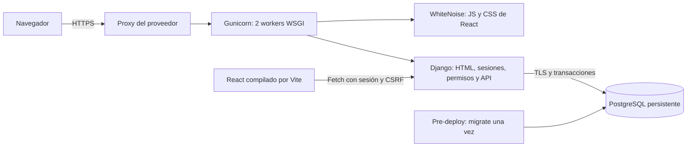

# Fase 3 — Producción, seguridad y persistencia

Fecha de auditoría y verificación final local: **28/10/2026**. Base: commit `0ec5a25` de Fase 2, con árbol de trabajo limpio al empezar la auditoría.

**Estado: preparación implementada y verificada localmente. Fase 3 todavía no completamente finalizada: falta desplegar y comprobar una URL pública real.** No se han contratado recursos, modificado infraestructuras externas ni realizado push. Las evidencias locales no acreditan disponibilidad remota, backups del proveedor ni persistencia después de un deploy en Render.

## 1. Objetivo

Conservar las Fases 1 y 2 y hacer verificables las garantías de integridad, seguridad, persistencia y operación. SAP sigue siendo un complemento independiente de Mirakl para gestionar planes de mejora. No se cambian políticas MQC ni umbrales, no se importan datos corporativos y no se amplía el negocio.

## 2. Auditoría inicial

Se revisaron `README.md`, `docs/fase-1.md`, `docs/fase-2.md`, arquitectura, despliegue, modelos, migraciones, servicios, formularios/Admin, serializadores, API, React, dependencias, scripts y CI. No se encontró `AGENTS.md` aplicable. No se utilizaron subagentes ni se alteraron los commits anteriores.

| Elemento | Estado inicial comprobado | Decisión |
| --- | --- | --- |
| Django 5.2.18 / Python 3.12.4 | ORM, sesiones, plantillas, API DRF; 58 tests originales aprobados | Conservar arquitectura |
| React 19.3.1 / Vite 7.3.7 | Compilación correcta; 6 casos Fetch existentes | Mantener interfaz y añadir sólo soporte de fiabilidad |
| SQLite local | Cero usuarios, vendedores, métricas, planes, acciones y revisiones | No migrar ni sustituir datos del usuario; mantener SQLite local |
| PostgreSQL | Driver 3.3.6 y configuración presentes; sin prueba previa real | Verificar con instancia aislada; usar gestionado en producción |
| Migraciones | Tres iniciales de dominio, restricciones y FK PROTECT | Conservarlas; añadir migración aditiva |
| Concurrencia | atomic y bloqueo del plan ya implementados; SQLite no los probaba | Tests con conexiones PostgreSQL independientes; impedir sobrescrituras obsoletas |
| Duplicados | Botón bloqueado durante envío y unicidad de revisiones; POST de planes/acciones no deduplicado | Claves UUID para reintentos de esas creaciones |
| Seguridad | CSRF, sesiones, roles, datos por vendedor, DEBUG=False/HTTPS preparados | Reforzar validación de configuración y acceso repetido |
| React/estáticos | Vite genera `dist`; Django renderiza índice; WhiteNoise ya instalado | Reutilizar todo bajo un origen |
| Despliegue | Preparación Vercel, sin URL; sin Gunicorn ni health check | Receta Render y WSGI simple, sin contenedores |
| Secretos | `.env` y SQLite ignorados; sin archivos de credenciales en el historial revisado | Conservar secretos fuera de Git; valores ficticios en ejemplos |
| CI | Workflow existente; no ejecución remota comprobada | Añadir PostgreSQL 16, conservar tests SQLite |

Riesgos prioritarios: bloqueos sin evidencia real, sobrescritura de formularios obsoletos, reintentos que podían duplicar altas, ausencia de un proceso de producción y de recuperación comprobado. No había una conexión disponible a Render/Railway ni variables de credenciales del proveedor. El coste y el push necesitan autorización explícita.

La inspección de secretos fue una revisión dirigida del código, configuración, archivos ignorados y nombres de archivos en Git; no equivale a una auditoría forense de todo el historial con un escáner especializado. No se encontró un secreto real expuesto que exigiera rotación. No se imprimió `.env`.

## 3. Cambios implementados

- Revisión incremental de planes, objetivos y acciones; rechazo de instancias/formularios obsoletos. React envía la revisión y presenta el conflicto 409 conservando los campos del formulario.
- `Idempotency-Key` UUID y huella del payload para crear planes/acciones: el reintento devuelve el registro existente; otros datos con la misma clave producen 409.
- Bloqueo de asignación del vendedor antes del plan en las escrituras API. Edición y borrado de vendedor se vuelven a autorizar bajo bloqueo. Admin incorpora bloqueo y revisión oculta en formularios editables.
- Configuración de producción validada, Gunicorn, endpoint SQL `/healthz/`, logs sin cuerpos/cookies/query string y bloqueo de intentos de login con django-axes.
- Alta interactiva de evaluador sin Admin y semilla representativa explícita, repetible y sin sobreescritura.
- Blueprint Render, scripts de build/release, CI PostgreSQL, QA de navegador público y ensayo local completo con restauración.
- README, arquitectura, despliegue, hoja de ruta y matriz académica actualizados.

Dependencias añadidas: **Gunicorn 26.2.0** (servidor WSGI) y **django-axes 8.3.1** (protección de acceso persistida en PostgreSQL). El resto se conserva fijado. Playwright 1.62.0, Chromium 151.0.7922.34 y pip-audit se usaron como herramientas de QA, no como dependencias de ejecución.

## 4. Arquitectura de producción

Django sigue siendo la autoridad del dominio. React no calcula el resultado de cierre ni almacena los planes localmente. Build y recolección de estáticos no escriben en la base; las migraciones se ejecutan antes del arranque, fuera de los workers. El disco web puede ser efímero: sólo contiene código y estáticos reconstruibles. No hay archivos subidos ni servicios distribuidos nuevos.

## 5. Base de datos seleccionada

**PostgreSQL gestionado para producción**, con PostgreSQL 16 propuesto explícitamente en Render y CI. El entorno disponible permitió verificar **PostgreSQL 14.24** real, no una emulación de bloqueos; la versión 16 remota sigue pendiente. SQLite sigue simplificando el desarrollo.

`DATABASE_URL` ya existía; se refuerza la exigencia TLS con DEBUG=False y se limita a cinco segundos el establecimiento de conexión. Se conserva `CONN_MAX_AGE=0`, adecuado al tamaño inicial y los dos workers. No hay pooling adicional.

Las FK, restricciones de estados/fechas/cierre y unicidades de las migraciones anteriores se aplicaron desde cero. No hubo incompatibilidades de consultas ni migraciones pendientes. `0002_concurrency_guards` añade revisiones, claves UUID y huellas; las claves son nulas en filas históricas, evitando colisiones de una migración con valor único repetido. Django-axes incorpora sus propias migraciones fijadas.

## 6. Persistencia

La base local original se mantuvo y se actualizaron sus migraciones de forma aditiva; seguía sin datos de negocio. Toda la QA creó recursos independientes y los eliminó al terminar.

En el ensayo con PostgreSQL, se compararon hashes SHA-256 del contenido ordenado de usuarios, grupos, permisos, asignaciones M2M, vendedores, políticas, observaciones, planes, objetivos, acciones y revisiones. Coincidieron después de reiniciar PostgreSQL, reiniciar Gunicorn y repetir `collectstatic` y `release.sh`. El plan cerrado, sus acciones, revisiones y evaluación conservaron los datos.

Es un **ensayo local de reinicio y repetición de release**, no evidencia de redespliegue en Render. La persistencia remota deberá comprobarse guardando el ID de un plan y consultándolo después de un deploy real, sin recargar semillas.

## 7. Seguridad

Se conservan sesiones Django, roles y permisos por operación, vendedores autorizados, CSRF en escrituras/login/logout, escape de salida y ORM. El frontend no concede acceso por sí mismo. Se mantienen negativas 403/404 a recursos ajenos, incluso manipulando IDs; cerrar exige permiso específico.

Producción rechaza claves cortas, SQLite, hosts vacíos/comodines, orígenes CSRF inseguros y PostgreSQL sin TLS. Render aporta su hostname exacto; no se autoriza `*.onrender.com`. Cookies Secure/HttpOnly para sesión, SameSite=Lax, expiración de sesión a ocho horas, HTTPS, HSTS, nosniff, DENY para iframes y referrer same-origin. Confianza en `X-Forwarded-Proto` sólo por variable explícita. Las trazas no se muestran al público. No se habilita CORS.

`/healthz/` devuelve únicamente `ok` o `unavailable`, con no-store; ejecuta una consulta sobre una tabla del esquema. Es la única excepción de redirección HTTPS para no convertir un probe interno 301 en una falsa confirmación de SQL saludable. Una parada real de PostgreSQL durante QA devolvió **503**.

Django-axes registra los intentos en base de datos: cinco fallos bloquean el usuario quince minutos. No se confía en IPs de cabeceras ni se almacenan IPs. Cambiar User-Agent, cookies o X-Forwarded-For no evita el bloqueo, comprobado con solicitudes independientes. No se guardan contraseñas ni tokens CSRF en el registro de fallos. El bloqueo puede causar indisponibilidad temporal a una cuenta atacada; el procedimiento de recuperación está documentado.

**Excepción justificada:** se silencia exclusivamente `axes.W006`. Este aviso genérico exige que la clave incluya IP; aquí la clave es el usuario global, sin depender de agentes/cookies/IP. Se comprobó su resistencia a esa rotación y se evita confiar en cabeceras no verificadas o bloquear a todos por la IP compartida del proxy. No se silencian advertencias de Django. `check --deploy --fail-level WARNING` indica cero incidencias y una comprobación silenciada documentada.

Pendientes externos: certificado público, comportamiento real del proxy, monitorización y retención de logs del proveedor. No se añade correo de recuperación ni auditoría general de todas las modificaciones. El restablecimiento de contraseñas es administrativo.

## 8. Concurrencia e integridad

Orden para escrituras HTTP: **vendedor autorizado → plan → escritura/validación**, dentro de `transaction.atomic`. Esto serializa las operaciones de un vendedor y permite continuar con vendedores distintos; no bloquea tablas completas. Admin usa el mismo orden para sus escrituras. Los modelos hijos conservan el bloqueo común del plan antes de comprobar que sigue abierto.

El cierre lee el estado vigente bajo bloqueo, calcula la instantánea y finaliza una sola vez. Una segunda finalización se rechaza sin alterar el resultado. Si la revisión gana la carrera, el cierre la incluye; si el cierre gana, la revisión se rechaza. Dos periodos válidos distintos se conservan. El periodo duplicado se rechaza por validación/restricción SQL. Un fallo de creación revierte plan y objetivos juntos.

`revision` protege las ediciones obsoletas en React y los formularios Admin. Los clientes API anteriores pueden omitirla por compatibilidad: sus escrituras siguen serializadas pero no detectan una edición obsoleta ocurrida antes de la solicitud. Los clientes nuevos deben enviar la revisión. Un modelo cargado antes de otra edición tampoco puede sobrescribirla mediante `save()`.

Las claves de reintento de planes/acciones se conservan con el registro; una repetición autorizada del mismo payload devuelve el estado actual, sin duplicar filas. Cambiar los datos genera otra clave en el frontend. No se promete deduplicación entre navegadores que generen claves distintas ni para clientes que omitan la cabecera. Las revisiones se protegen por su unicidad de objetivo/periodo.

**Ocho pruebas de concurrencia reales**: doble cierre, revisiones distintas, revisión duplicada, acción obsoleta, revisión contra cierre, bloqueo PostgreSQL con `nowait` y acceso tras reasignación, altas simultáneas con misma clave, y edición simultánea del plan con misma revisión. Usan `TransactionTestCase`, hilos y conexiones separadas; se omiten en SQLite.

Límite conservado: SQL directo, `QuerySet.update()` y cargas masivas pueden eludir validaciones de dominio; no forman parte de las rutas de escritura soportadas. No se concede acceso SQL a evaluadores. No se ha diseñado un sistema de importaciones concurrentes de políticas/observaciones.

## 9. Plataforma de despliegue

Render se propone por su runtime Python, PostgreSQL persistente, HTTPS gestionado y pre-deploy. `render.yaml` define un servicio web `0.5c-512mb`, PostgreSQL `0.1c-256mb` con 1 GB y región Frankfurt; no hay publicación automática por commit ni acceso externo a la base. Son recursos de pago **sin contratar**.

La configuración se contrastó con la [referencia vigente de Blueprint](https://render.com/docs/blueprint-spec); los identificadores actuales difieren de ejemplos antiguos `starter`/`basic-256mb`. La configuración no ha sido aceptada por una cuenta real de Render. El precio debe confirmarse en el panel antes de autorizar. [Precios](https://render.com/pricing).

Railway es una alternativa con facturación por consumo. Render Free no se propone para la evaluación estable: suspensión por inactividad y limitaciones de continuidad/recuperación de la base. Las fuentes, alternativas y pasos están en [despliegue](despliegue.md).

## 10. Variables de entorno

`.env.example` conserva la configuración local y añade `SAP_DEMO_MODE=False`. Producción utiliza `DJANGO_SECRET_KEY`, `DJANGO_DEBUG=False`, `DATABASE_URL`, hosts/orígenes exactos, `DJANGO_TRUST_PROXY`, hostname del proveedor, `PORT` y `WEB_CONCURRENCY`. `.python-version` fija la rama 3.12 y Node la rama 22, con parche mantenido del proveedor.

La tabla completa y cómo configurar dominios adicionales están en [docs/despliegue.md](despliegue.md#variables-y-secretos). Ninguna variable `VITE_*` contiene secretos. El valor de la clave permanece privado y no se regenera al arrancar o redesplegar, para conservar las sesiones válidas.

## 11. Procedimiento de despliegue

1. Aprobar el diff y guardar el hito local; autorizar el push por separado.
2. Autorizar cuenta, recursos y coste Render; revisar que los nombres no afecten a servicios existentes.
3. Aplicar el Blueprint, introducir la clave privada y revisar variables y acceso a la base.
4. Build `bash scripts/build.sh`; pre-deploy `bash scripts/release.sh`; arranque Gunicorn según Blueprint.
5. Crear evaluador sin Admin mediante `create_demo_agent`; cargar demo con `SAP_DEMO_MODE=True` y confirmación explícita; desactivar después ese modo.
6. Verificar URL real, navegador, permisos y persistencia tras nuevo despliegue; activar y verificar recuperación/alertas.

Procedimiento reproducible, criterios y rollback en [despliegue](despliegue.md). Nada de estos pasos externos se considera ejecutado por la sola existencia de configuración.

## 12. Migraciones

Se verificó `migrate` sobre PostgreSQL vacío y durante la creación de las bases de test SQLite/PostgreSQL. `makemigrations --check --dry-run` no encuentra cambios de modelo. `migrate --check` pasa en origen y en restauración. `release.sh` se repitió conservando los datos. Las migraciones históricas no se editaron.

Se aplicaron localmente la migración aditiva y las de axes para que el checkout siga arrancando con su SQLite original. En producción debe ejecutarse el pre-deploy una vez por release, con backup/punto de recuperación disponible y sin lanzar migraciones desde múltiples workers.

## 13. Pruebas ejecutadas

| Comando o prueba | Entorno | Resultado |
| --- | --- | --- |
| `cd backend && ../.venv/bin/python manage.py test --verbosity 1` antes de cambios | SQLite | 58/58 originales |
| Mismo comando final | SQLite | 77 descubiertas: 69 aprobadas y 8 omitidas por requerir PostgreSQL |
| `python3 scripts/verify_phase3.py --pg-bin /usr/lib/postgresql/14/bin` | QA aislada PostgreSQL 14.24 | 77/77 aprobadas, incluidas 8 de concurrencia; proceso completo exit 0 |
| `node --test --experimental-test-isolation=none --test-reporter=spec src/services/api.test.js` | Node 22.19.0 | 7/7 casos JavaScript |
| `npm run build` | Node 22.19.0 / Vite | Correcta; JS 279,06 kB, gzip 84,67 kB |
| `migrate --noinput`, `makemigrations --check --dry-run`, `migrate --check` | SQLite y PostgreSQL | Correctos, sin deriva de modelos |
| `check --deploy --fail-level WARNING` | DEBUG=False y PostgreSQL real en QA | Cero incidencias; axes.W006 silenciado con justificación |
| `python scripts/check_production.py` | Variables ficticias | Correcto; por sí solo no abre conexión |
| `collectstatic --noinput` y repetición | QA y checkout | Correctos; CSS/JS servidos realmente por WhiteNoise |
| `python -m pip check` | venv de la aplicación | Sin dependencias incompatibles |
| `npm audit --json` | Consulta al registro npm | Cero vulnerabilidades conocidas, incluidas dependencias de desarrollo |
| `pip-audit -r backend/requirements.txt --no-deps --disable-pip` | Herramienta aislada de QA | Cero vulnerabilidades conocidas en los 12 paquetes fijados |
| Playwright/Chromium sobre Gunicorn | DEBUG=False, HTTPS local y PostgreSQL | Flujo completo, permisos, CSRF, escritorio 1440 px y móvil 390 px |
| Reinicios PostgreSQL/Gunicorn y repetición de release | QA | Huellas de datos coincidentes |
| `pg_dump` + `pg_restore --single-transaction --exit-on-error` | Otra base vacía | Restauración coincidente; migraciones aplicadas |
| `git diff --check` | Repositorio | Correcto |
| URL pública / TLS público / CI remoto | Proveedor | **No ejecutados; pendientes** |

Las auditorías de paquetes consultan avisos conocidos en esa fecha; no certifican ausencia de vulnerabilidades. La primera consulta de red fue bloqueada por el sandbox y se repitió con permiso. No se instaló pip-audit en el venv de la aplicación.

Medición local con cliente Django autenticado, cinco peticiones por ruta, **125 vendedores y 857 observaciones**:

| Ruta | Consultas | Mediana | Máximo |
| --- | ---: | ---: | ---: |
| Dashboard `/api/overview/` | 25 | 128,06 ms | 190,97 ms |
| Directorio `/api/sellers/` | 6 | 11,36 ms | 20,57 ms |
| Planes `/api/plans/` | 10 | 22,17 ms | 25,00 ms |
| Planes abiertos | 10 | 28,41 ms | 34,32 ms |

La prueba de regresión mantiene el número de consultas al pasar de un vendedor a más de cien. No se detectó N+1 en esas rutas. No se presenta como prueba de carga concurrente o latencia de Internet; el tamaño mínimo de Render todavía no se ha medido. El detalle de un plan con histórico extraordinario continúa sin paginación.

## 14. Recorrido funcional

Comprobado **localmente con configuración de producción**, sin Django Admin:

1. Login del agente ficticio sin privilegios administrativos y dashboard con datos Django.
2. Buscar `SAP-DEMO-PLAN`, abrir vendedor con incidencias del 6% y crear otro plan con objetivo 3%.
3. Registrar problema, causa raíz, evidencia, objetivo, responsable y plazo. Probar objetivo inválido y corregirlo conservando el formulario.
4. Editar diagnóstico; crear dos acciones, activar el plan y pasarlo a revisión.
5. Completar una acción con evidencia; mantener la preventiva pendiente.
6. Registrar agosto 4,5% y septiembre 3%, cada periodo con cien pedidos ficticios.
7. Verificar objetivo alcanzado; cerrar con razones y confirmación.
8. Recargar: conservar dos acciones, dos revisiones, cierre y evaluación `achieved`.
9. Rechazar una escritura sin CSRF; otro agente recibe 404 al consultar e intentar cerrar el plan.
10. Comprobar móvil de 390 px, ausencia de errores JavaScript y de respuestas 5xx/errores de estáticos durante el flujo.

La captura muestra explícitamente los periodos históricos y una acción pendiente en el cierre. El resultado procede del backend. El certificado local de un día se crea sólo para QA; Chromium acepta expresamente ese certificado de prueba. El script público valida el certificado normalmente.

**Ninguno de estos pasos se ha comprobado aún desde una URL pública.** `scripts/verify_browser.py` deja preparado el mismo recorrido para ejecutarlo después de publicar, con credenciales privadas y consentimiento explícito para crear el plan ficticio.

Capturas ficticias locales: [dashboard](screenshots/fase-3-dashboard.png), [cierre](screenshots/fase-3-cierre.png), [móvil](screenshots/fase-3-movil.png). [Resumen de evidencia en JSON](evidencias-fase-3.json).

## 15. Copias y recuperación

Se probó una copia PostgreSQL en formato custom y restauración completa en una segunda base, sin sobrescribir el origen. Se compararon todos los registros de dominio, usuarios, permisos y sus asignaciones mediante recuentos/huellas, y se comprobó el estado de migraciones. La copia temporal y las bases se eliminaron tras verificar.

Para Render se propone PITR del proveedor y exportación privada diaria con retención de siete días, supervisada por el titular. Son medidas **pendientes de provisión y configuración**. Según la documentación actual, PostgreSQL de pago en workspace Hobby ofrece PITR de tres días; Pro o superior, siete. No se confunden estas ventanas con la retención propuesta de exportaciones. [Backups Render](https://render.com/docs/postgresql-backups).

El runbook especifica alcance, responsable, `pg_dump`, `PGPASSFILE`, cifrado/almacenamiento fuera de la web, restauración vacía sin `--clean`, validación y cambio de conexión sólo tras autorización. No hay backups automáticos remotos activos que se puedan afirmar en esta entrega.

## 16. Problemas encontrados

- El sandbox bloqueaba sockets y algunas consultas de auditoría: se pidió el permiso específico y se ejecutó QA aislada, sin acceder a datos externos.
- Un primer `manage.py test` desde la raíz descubrió cero pruebas. No se contó como validación: los resultados válidos proceden de `backend/`.
- El primer ensayo de navegador agotó la espera de un vendedor; se añadió una aserción explícita de disponibilidad y captura de fallo. Los ensayos completos posteriores pasaron.
- Una prueba de django-axes asumía una fila por usuario; el paquete conserva intentos por contexto y suma por usuario. Se corrigió la aserción para inspeccionar todas las filas; el bloqueo con rotación ya devolvía 429.
- La repetición de release en QA usaba Python del sistema sin Django. Se corrigió el PATH del entorno de QA; `release.sh` pasó en el ensayo completo.
- La documentación vigente de Render cambió identificadores de tamaños respecto a ejemplos antiguos: se ajustó el Blueprint a la referencia consultada.
- La negociación del certificado autofirmado de QA genera avisos de certificado en Gunicorn durante Chromium. No son un certificado público ni se han ocultado como validación de la cadena remota.

## 17. Limitaciones y aceptación pendiente

| Criterio | Estado |
| --- | --- |
| Django + React y funcionalidades anteriores | Verificados localmente |
| Migraciones, restricciones, PostgreSQL y concurrencia | Verificados en PostgreSQL 14.24; 16 remoto pendiente |
| Seguridad de configuración y controles de acceso | Verificados localmente; proxy/HTTPS real pendiente |
| Persistencia tras reinicios y release repetido | Verificada localmente; deploy real pendiente |
| Recuperación de backup | Restauración local verificada; backup/PITR remoto pendiente |
| URL pública, login remoto y estáticos remotos | Pendientes |
| Cuenta/proyecto, coste y push | Requieren acceso/autorización del titular |
| GitHub Actions | Configurado; ejecución remota pendiente |
| Memoria, vídeo y defensa | Fase 4 |

No se declara la Fase 3 finalizada por existir `render.yaml`. Tampoco se garantiza una nota ni se atribuyen propiedades de alta disponibilidad al tamaño mínimo elegido. El entorno público sólo debe contener datos ficticios; no se conectó a Mirakl, PcComponentes ni vendedores reales.

## 18. Preparación para Fase 4

Evidencia reutilizable: arquitectura, decisiones de motor/proveedor, migración aditiva, pruebas de carreras y permisos, trazabilidad de seguridad, demo, mediciones y recuperación. `artifacts/phase3/` contiene logs y JSON locales ignorados por Git; el resumen revisado y capturas ficticias se incluyen en la documentación. Los informes de Fases 1 y 2 se conservan históricos.

Antes de redactar la memoria definitiva, añadir la URL real, commit desplegado, fecha de aceptación, evidencia de persistencia remota y recuperación del proveedor. Preparar memoria PDF/Word, vídeo de máximo cinco minutos y defensa de hasta veinte minutos; esta fase no sustituye esos entregables. La [matriz académica](trazabilidad-requisitos.md) separa requisitos técnicos satisfechos y pendientes; se sigue la guía transcrita en el encargo, sin inventar certificación docente.
