# Seller Action Plan (SAP)

**Proyecto Final de Máster en Desarrollo Full Stack**

ConquerBlocks · **Pablo Rosales**

28 de octubre de 2026 · Versión documental 1.0 — Fase 4

Código del producto auditado: `49ee19800e35ae72602e6cc7f76e1e6c374ae0d6`.

**Memoria preparada para revisión; entrega pendiente de despliegue público, vídeo y confirmación administrativa.** La preparación documental no acredita una publicación en producción. Las imágenes muestran ejecuciones reales de SAP con datos ficticios en QA local.

Proyecto académico independiente inspirado en la experiencia profesional del autor como Marketplace Support Agent en PcComponentes. No es una herramienta oficial de PcComponentes ni de Mirakl y no utiliza datos corporativos.

## Resumen ejecutivo

Seller Action Plan aborda el seguimiento de acciones de mejora de vendedores de marketplace. Consultar un indicador permite detectar una desviación, pero no explica por sí solo su causa, quién realizará una acción, cuándo debe revisarse ni cómo quedará documentado el resultado. SAP reúne esas decisiones en un plan vinculado al vendedor y a sus observaciones de calidad.

La aplicación utiliza Django y Django REST Framework para autenticación, autorización, validación, API y persistencia; React para la interfaz operativa; y PostgreSQL como motor previsto para producción. Conserva plantillas Django para acceso y portal. Los datos se intercambian mediante JSON y sesiones del mismo origen, sin integrar la API de Mirakl.

El producto implementa dashboard, búsqueda y ficha de vendedores, políticas versionadas, planes con varios objetivos, acciones correctivas y preventivas, revisiones históricas, evaluación y cierre documentado. El ciclo ficticio de incidencias 6% → 4,5% → 3% se ha reproducido en Chromium con Django, Gunicorn y PostgreSQL. Las 77 pruebas Django, incluidas ocho de concurrencia, pasan en PostgreSQL local; siete casos JavaScript y la compilación React también pasan. Se ha comprobado persistencia tras reinicios y restauración en otra base. La CI de Fase 3 está aprobada en GitHub.

Estos resultados demuestran comportamiento técnico en el entorno ensayado. No demuestran una mejora empresarial ni disponibilidad en Internet. La publicación, la aceptación remota y el vídeo obligatorio siguen pendientes; se proporcionan procedimientos y guiones para completarlos.

## 1. Introducción y contexto

En un marketplace, distintos vendedores comercializan productos a través de una plataforma común. La atención operativa necesita revisar la calidad del servicio y coordinar mejoras cuando aparecen desviaciones. El proyecto nace de la experiencia del autor en Marketplace Support: junto al dato cuantitativo, hace falta conservar diagnóstico, compromisos, responsables y evidencia de seguimiento.

Mirakl sirve de contexto operativo. MQC permite supervisar determinados indicadores y sus límites; los criterios públicos de PcComponentes describen cinco métricas automatizadas, mientras que NPS y eficiencia de entrega tienen un tratamiento independiente. SAP registra observaciones y clasifica sus valores según políticas guardadas, pero no obtiene pedidos de Mirakl ni reproduce sus procesos administrativos. [Criterios de calidad automatizados](https://marketplacehelp.pccomponentes.com/hc/es-es/articles/20561228339357-criterios-de-calidad-automatizados).

La referencia pública sobre planes propone analizar causas, concretar acciones y revisar resultados. SAP materializa ese seguimiento en una aplicación independiente: ayuda a organizar el trabajo del agente, sin ejecutar suspensiones, bloquear pagos ni tramitar reaperturas. [Preparación de planes de acción](https://marketplacehelp.pccomponentes.com/hc/es-es/articles/38119386983965-como-mejorar-tus-indicadores-de-calidad-y-preparar-un-plan-de-accion).

## 2. Definición del problema

La necesidad abordada es conservar un proceso coherente entre detectar una desviación y decidir cómo termina su seguimiento. Cuando el diagnóstico, los compromisos y las revisiones se guardan en lugares separados, resulta difícil reconstruir qué se acordó, qué plazo estaba vigente y qué dato respalda el cierre. Este es el problema de diseño de SAP; no se presenta como una auditoría de procedimientos internos de una empresa.

El usuario afectado es el agente que gestiona una cartera de vendedores. Necesita identificar prioridades, consultar el contexto de cada observación y mantener continuidad entre revisiones. El administrador debe poder asignar vendedores, habilitar permisos y registrar políticas y observaciones iniciales.

SAP propone una unidad de trabajo explícita: el plan de mejora. Cada plan conecta vendedor, problema, periodo, causa raíz, evidencia, objetivo, responsable y fechas. Dentro de él se registran acciones y revisiones; la evaluación compara mediciones con metas y el cierre conserva una instantánea del resultado. Así, una cifra deja de estar aislada y pasa a formar parte de un seguimiento consultable.

Mirakl continúa siendo el sistema externo de referencia para la operativa real. SAP no intenta sustituirlo: no gestiona catálogo, pedidos, cobros ni sanciones, y tampoco necesita acceso a su API para demostrar su alcance académico.

## 3. Aportación y eficiencia

El valor funcional reside en centralizar información relacionada y hacer explícitas las decisiones. El dashboard reúne tareas pendientes, vencimientos y planes por revisar. La ficha del vendedor conecta observaciones e histórico. El detalle del plan mantiene diagnóstico, ejecución y evaluación en el mismo contexto.

| Necesidad | Respuesta implementada | Alcance de la evidencia |
| --- | --- | --- |
| Localizar compromisos | Acciones con responsable, fecha, estado y evidencia | Datos persistidos y visibles en React |
| Mantener continuidad | Revisiones con autor, periodo y fecha de registro | Histórico conservado por las rutas soportadas |
| Priorizar trabajo | Contadores, próximas acciones y planes por revisar | Resultado calculado por el backend |
| Evaluar con criterio | Inicial, objetivo, última revisión y dirección de mejora | Casos de prueba y demostración ficticia |
| Justificar el cierre | Razones e instantánea de evaluación | Cierre transaccional y consultable |

Se espera reducir la dispersión de información y facilitar la preparación de seguimientos. No se han medido tiempos de trabajo, productividad, satisfacción de agentes ni impacto económico. Las mediciones de latencia local describen rendimiento del software y no son una medición de eficiencia laboral.

Una evaluación futura podría comparar un mismo escenario ficticio con y sin SAP, registrando tiempo, errores y facilidad para recuperar evidencias. Sería necesario describir participantes, procedimiento y limitaciones antes de atribuir mejoras. En esta entrega el valor aportado se fundamenta en funcionalidades comprobadas y en su adecuación al problema.

## 4. Objetivos y alcance

El objetivo general es desarrollar una aplicación Full Stack que convierta desviaciones de calidad registradas en un proceso de mejora documentado, medible y protegido por permisos.

Los objetivos específicos son relacionar vendedores y observaciones; conservar diagnóstico y metas; organizar responsables y plazos; registrar revisiones sin sobrescribir las anteriores; separar ejecución de acciones y cumplimiento de objetivos; permitir un cierre razonado; y comprobar que otro agente no puede acceder a una cartera ajena.

El MVP incluye autenticación, administración inicial, lectura de indicadores, dashboard, listados y formularios de planes, acciones, revisiones y cierre. La API permite gestionar vendedores propios; la interfaz React se centra en consultarlos y gestionar planes. Las políticas, observaciones globales y asignaciones se mantienen mediante administración autorizada. No existe formulario React de importación de indicadores.

Quedan fuera del alcance integración con Mirakl, cuentas de vendedores externos, sanciones automáticas, notificaciones, adjuntos binarios, informes exportables del producto, inteligencia artificial y analítica avanzada. La exportación de esta memoria es una herramienta documental, no una funcionalidad de SAP.

## 5. Tecnologías utilizadas

| Tecnología del repositorio | Uso y justificación |
| --- | --- |
| Python 3.12; Django 5.2.18 | Modelos, migraciones, vistas, plantillas, ORM y autenticación en una base coherente |
| Django REST Framework 3.18.3 | Serializadores, permisos, respuestas JSON y paginación de la API |
| React / React DOM 19.3.1 | Formularios y vistas operativas que presentan datos reales de Django |
| JavaScript, HTML y CSS | Interacción, estructura semántica, estados de interfaz y adaptación a móvil |
| Vite 7.3.7; Node 22 en QA | Desarrollo y compilación del frontend; Node no sirve el backend en producción |
| PostgreSQL; psycopg 3.3.6 | Persistencia externa al disco web, transacciones y bloqueos reales de fila |
| SQLite | Arranque local sencillo; no acredita concurrencia PostgreSQL |
| Gunicorn 26.2.0 | Servidor WSGI de la aplicación, con dos workers por defecto |
| WhiteNoise 6.12.0 | Entrega de estáticos Django y React compilados desde el mismo origen |
| django-environ 0.14.0; tzdata 2026.5 | Configuración por entorno y fechas en Europe/Madrid |
| django-axes 8.3.1 | Bloqueo persistente de intentos de autenticación repetidos |
| Git y GitHub Actions | Evolución por fases y verificación automática con SQLite y PostgreSQL 16 |
| Django TestCase / TransactionTestCase; node:test | Pruebas de dominio, API, seguridad, concurrencia y cliente HTTP |
| Playwright / Chromium; herramientas PostgreSQL | QA de navegador, reinicios, copia y restauración aisladas |
| Render, propuesto | Receta de despliegue con PostgreSQL y HTTPS gestionado; aún no aplicado |

Las versiones proceden de los archivos fijados y del entorno revisado. PostgreSQL local es 14.24; Render y CI utilizan o proponen 16 según su contexto. Las herramientas de QA y exportación no se añaden a las dependencias de ejecución del producto. El diseño evita incorporar servicios adicionales cuando las capacidades de Django resuelven el alcance.

## 6. Arquitectura del sistema

SAP es un monolito Django con una interfaz React compilada. La división en aplicaciones `sellers`, `quality` y `action_plans` separa responsabilidades de dominio sin distribuir el sistema en varios servicios. `config` contiene ajustes, rutas y vistas generales.

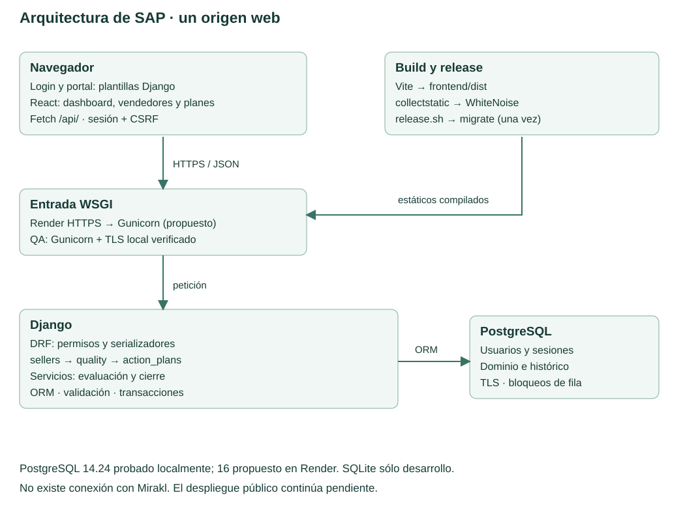

El navegador inicia sesión mediante una plantilla Django. Después, `/dashboard/` entrega el índice generado por Vite. React consulta `/api/workspace/` para conocer sesión, capacidades y token CSRF enmascarado, y obtiene el resumen de `/api/overview/`. El cliente Fetch de `frontend/src/services/api.js` mantiene `credentials: same-origin` y envía `X-CSRFToken` en escrituras.

En una petición de detalle, React solicita `/api/plans/ID/`; DRF comprueba la sesión y el rol, `PlanViewSet` exige permisos y filtra por vendedores visibles, el ORM consulta el plan con relaciones precargadas y el serializador devuelve JSON con su evaluación. React presenta esa respuesta. En una escritura, Django valida datos y relaciones dentro de la transacción antes de devolver el estado persistido. La interfaz no decide por su cuenta si un objetivo se ha alcanzado.

La navegación React usa fragmentos como `#/sellers` y `#/plans/ID`, conservando una única vista Django de entrada. En desarrollo Vite reenvía API y acceso a Django; en la compilación integrada WhiteNoise entrega los recursos de `/static/react/`. No se necesita CORS ni un segundo servidor de frontend en producción.

El build instala dependencias fijadas, compila y recoge estáticos. El release ejecuta migraciones una vez; Gunicorn únicamente arranca WSGI. Los datos permanecen en PostgreSQL. Esta separación evita ejecutar migraciones por cada worker o guardar la base en un disco web efímero. Véanse `scripts/build.sh`, `scripts/release.sh` y `backend/gunicorn.conf.py`.

## 7. Modelo de datos

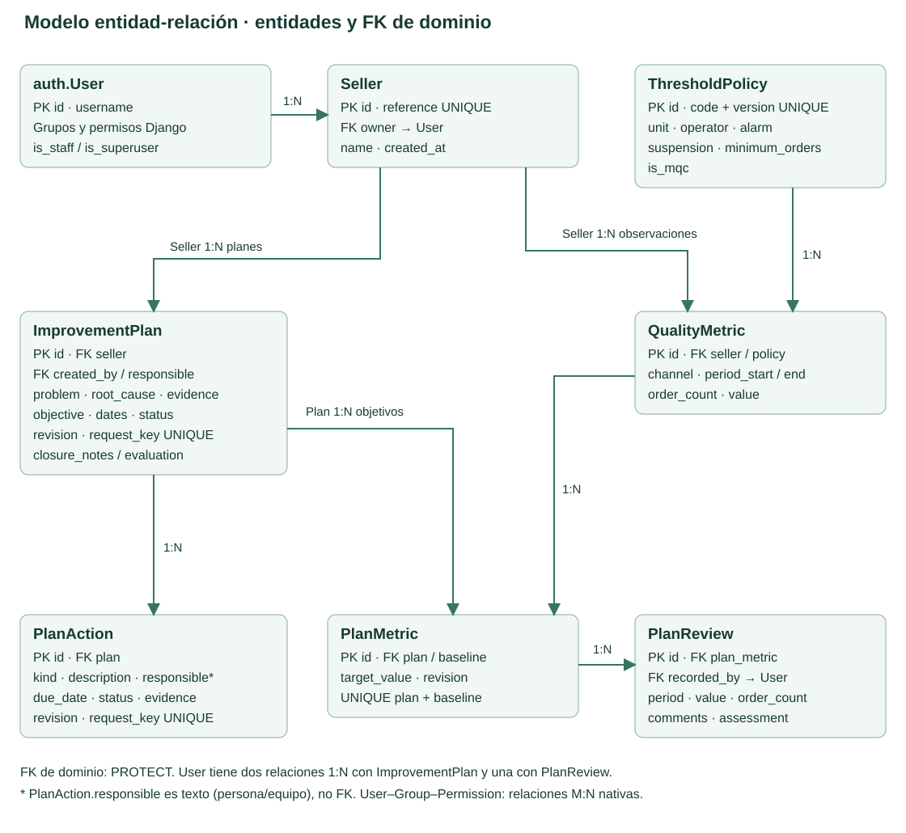

| Entidad | Responsabilidad y relaciones |
| --- | --- |
| `auth.User` | Usuario Django, grupos y permisos; se conserva el modelo nativo |
| `Seller` | Nombre y referencia única; `owner` identifica al agente con acceso |
| `ThresholdPolicy` | Código y versión únicos; unidad, operador, límites y condiciones MQC |
| `QualityMetric` | Observación de vendedor, política, canal, periodo, pedidos y valor |
| `ImprovementPlan` | Vendedor, autor, responsable, diagnóstico, fechas, estado y cierre |
| `PlanMetric` | Une plan y observación inicial (`baseline`) con una meta decimal |
| `PlanAction` | Acción del plan; responsable textual, plazo, estado y evidencia |
| `PlanReview` | Revisión de un objetivo: valor, periodo, autor, comentarios y valoración |

Las revisiones derivan indicador, unidad y canal de la observación inicial. No actualizan `QualityMetric`: una revisión del plan no transforma automáticamente el indicador global del vendedor. Esta separación conserva el significado de las dos fuentes de observación y explica por qué el dashboard puede seguir mostrando una desviación histórica global tras cerrar un plan.

Las FK de dominio usan `PROTECT`. Las políticas utilizadas y las observaciones iniciales vinculadas a objetivos quedan protegidas frente a cambios mediante las rutas soportadas. Se utilizan decimales para metas y valores. Las restricciones SQL cubren, entre otras condiciones, periodos válidos, unicidades y coherencia de estados finales. `full_clean()` y los servicios validan relaciones entre entidades y transiciones.

La inmutabilidad no equivale a una base invulnerable a un administrador SQL. `QuerySet.update()`, cargas masivas y SQL directo pueden saltarse validaciones de aplicación; no forman parte de las rutas de escritura admitidas para este flujo. La unicidad de observaciones entre versiones de políticas también requiere validación de aplicación. No se implementa una auditoría general de todos los cambios.

## 8. Tipos de usuarios y permisos

Los perfiles funcionales son administrador y agente. «Account Manager» describe un posible usuario profesional, pero no es un grupo distinto implementado. No existe un rol de vendedor externo.

| Operación | Anónimo / sin rol | Marketplace Agent | Superusuario |
| --- | --- | --- | --- |
| Datos de negocio | No | Vendedores asignados | Todos |
| CRUD de vendedores por API | No | Propios; propietario impuesto por servidor | Todos |
| Reasignar vendedores | No | No | Django Admin |
| Leer indicadores | No | De vendedores visibles | Todos |
| Registrar políticas/observaciones globales | No | No | Django Admin |
| Consultar planes | No | Además requiere `view_improvementplan` | Sí |
| Crear/editar objetivos, planes y acciones | No | Permisos específicos y plan accesible | Sí, con validación de dominio |
| Registrar revisiones | No | `add_planreview` y acceso al plan | Sí |
| Cerrar/cancelar | No | Cambio y permiso específico de cierre | Sí, con reglas de cierre |
| Editar histórico final por API/Admin | No | No | No mediante esas rutas |
| Acceder a Admin | No | Sólo si tiene `is_staff` y permisos | Cuenta activa con `is_staff` |

`is_staff` no concede acceso a los datos por sí solo. El campo `responsible` de un plan tampoco cambia permisos: el ámbito deriva de `Seller.owner`. La reasignación administrativa transfiere el acceso al histórico, conservando los autores. Las revisiones se añaden y no se editan ni borran por la API.

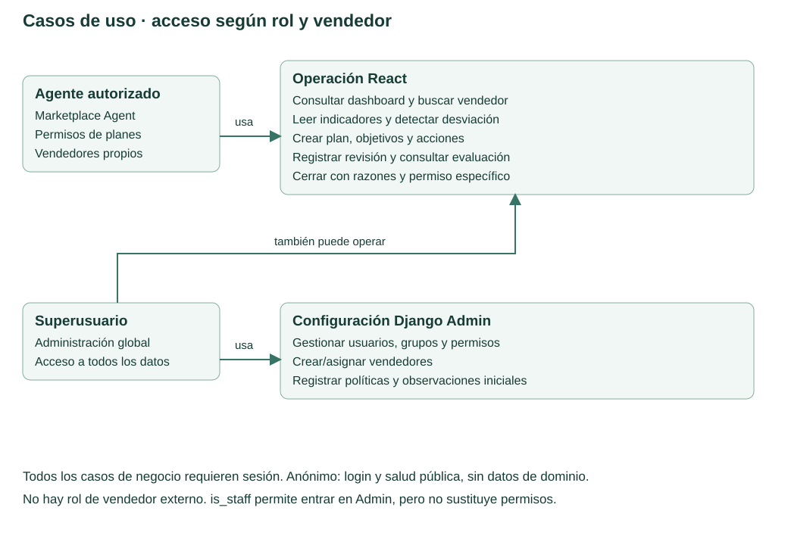

## 9. Casos de uso

### CU01. Iniciar sesión

Actor: usuario activo. Precondición: cuenta creada administrativamente. Flujo: abrir login, introducir credenciales y enviar el formulario con CSRF. Resultado: sesión Django y navegación al dashboard. Alternativas: credenciales incorrectas; bloqueo tras cinco fallos durante quince minutos; cuenta sin rol que no puede acceder a datos. El logout usa POST y termina la sesión.

### CU02. Consultar dashboard

Actor: agente con permisos de consulta de planes. Precondición: sesión válida. Flujo: React consulta el resumen y muestra vendedores, planes abiertos, acciones pendientes/vencidas y revisiones. Resultado: vista priorizada de su cartera. Alternativas: estado vacío, falta de permisos o error de red. Una acción pendiente de un plan ya finalizado no aparece como trabajo pendiente de planes abiertos.

### CU03. Buscar vendedor

Actor: agente. Precondición: vendedor asignado. Flujo: abrir directorio, buscar por referencia o nombre y acceder a la ficha. Resultado: indicadores e histórico del vendedor autorizado. Alternativas: búsqueda vacía o ID inexistente/ajeno; el backend devuelve 404 en el detalle ajeno.

### CU04. Identificar desviación

Actor: agente. Precondición: observación registrada por administrador. Flujo: consultar valor, periodo, canal, volumen y clasificación. Resultado: contexto para decidir un plan. Alternativas: ausencia de datos, periodo no mensual o volumen insuficiente para MQC; SAP no deduce una evaluación válida cuando faltan condiciones.

### CU05. Crear plan

Actor: agente con permisos de creación de plan y objetivo. Precondición: vendedor y observación accesibles. Flujo: completar título, problema, causa, evidencia, objetivo, responsable, plazo y meta numérica; guardar. Resultado: borrador y objetivos creados atómicamente. Alternativas: meta que no mejora el valor inicial, fechas incoherentes o relación ajena; la operación se rechaza sin dejar un plan parcial.

### CU06. Gestionar acciones

Actor: agente con permiso de acción. Precondición: plan abierto. Flujo: añadir descripción, tipo, responsable textual y plazo; activar el plan cuando tenga al menos un objetivo y una acción; completar una acción con fecha y evidencia. Resultado: compromiso y ejecución persistidos. Alternativas: plazo fuera del plan, falta de evidencia o revisión obsoleta; se valida o devuelve conflicto 409 para recargar.

### CU07. Registrar revisión

Actor: agente con permiso de revisión. Precondición: objetivo accesible de plan abierto. Flujo: indicar fecha, periodo, medición, pedidos, comentarios, valoración y próximos pasos. Resultado: nueva revisión con autor impuesto por el servidor. Alternativas: periodo repetido, fechas inválidas, plan cerrado o datos insuficientes. Una revisión válida como registro puede quedar no evaluable para MQC.

### CU08. Evaluar resultado

Actor: agente. Precondición: objetivo con sus revisiones disponibles. Flujo: consultar comparación inicial/meta/actual. Resultado: mejora respecto al inicio y cumplimiento de meta calculados por Django. Alternativas: sin medición evaluable, resultado `not_evaluable`; con varios objetivos, todos deben ser evaluables y alcanzarse para éxito global. La última revisión se elige por periodo medido, fecha e ID.

### CU09. Cerrar plan

Actor: agente con cambio y cierre. Precondición: estado que permita finalizar. Flujo: consultar evaluación y acciones, indicar razones y confirmar. Resultado: fecha, razones e instantánea guardadas en una transacción; histórico consultable. Alternativas: sin permiso, sin razones, revisión obsoleta o doble cierre. Puede cerrarse sin alcanzar metas si se documenta la decisión; no se completan acciones automáticamente. Un borrador debe activarse antes de cerrarlo, aunque puede cancelarse.

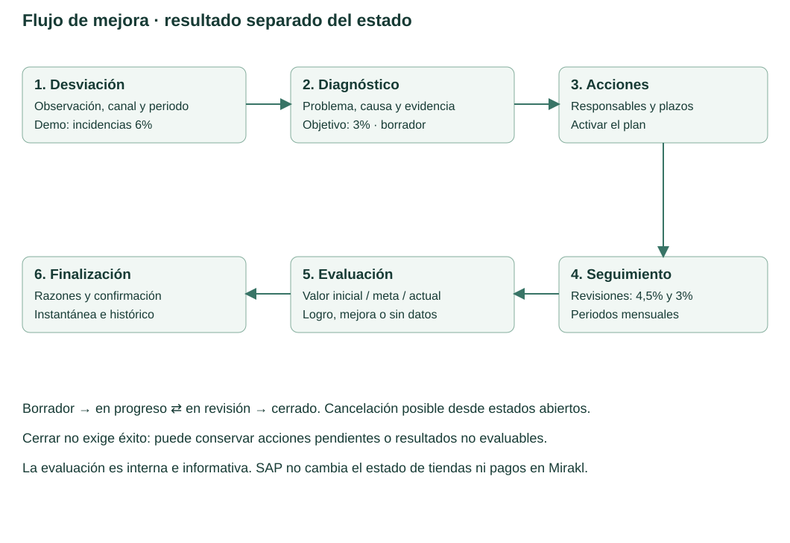

## 10. Seguridad y protección de datos

La autenticación utiliza sesiones Django y contraseñas almacenadas con el hashing predeterminado del framework, PBKDF2, además de validadores de contraseña. No se almacenan claves en el frontend ni se usa JWT. Las sesiones duran ocho horas. Django-axes registra intentos en base de datos y aplica el bloqueo por usuario, de modo que cambiar cookies o User-Agent no evade esa clave de bloqueo.

La autorización se ejecuta en el servidor. `IsMarketplaceAgent` comprueba rol, `visible_sellers()` limita la cartera y `visible_plans()` deriva ese alcance. Los endpoints del módulo exigen permisos específicos; una relación válida por ID sigue siendo inválida si pertenece a otro agente. La autoría y el propietario de nuevas altas se imponen desde la sesión.

CSRF protege login, logout y escrituras autenticadas. El token no sustituye la sesión ni el permiso. React envía el token en una cabecera y las plantillas incluyen el campo de formulario. Django y React escapan el texto mostrado; no se utiliza HTML proporcionado por el usuario. El ORM evita construir SQL con texto de entrada. Estas medidas reducen riesgos, sin constituir una auditoría de penetración completa.

Con `DEBUG=False`, la configuración exige secreto adecuado, hosts exactos y PostgreSQL con TLS. Activa cookies `Secure`, sesión `HttpOnly`, `SameSite=Lax`, HSTS, redirección HTTPS, `nosniff` y bloqueo de iframes. La confianza en `X-Forwarded-Proto` debe habilitarse sólo detrás de un proxy confiable. `/healthz/` permite el probe HTTP interno y únicamente informa si la consulta SQL funciona.

Las escrituras del flujo bloquean primero el vendedor autorizado y después el plan, dentro de `transaction.atomic()`. La revisión numérica detecta formularios obsoletos y produce 409. Las claves UUID de idempotencia deduplican reintentos de creación de planes y acciones. Las revisiones históricas tienen unicidad por objetivo/periodo. Los clientes antiguos que omiten revisión o clave no reciben todas esas garantías adicionales; no se afirma una deduplicación universal.

El cierre comparte bloqueos con las revisiones: si una revisión se confirma primero, puede formar parte de la evaluación; si gana el cierre, la revisión posterior se rechaza. Ante una excepción, la transacción revierte el cambio y no deja un cierre parcial. Las ocho pruebas de concurrencia utilizan conexiones independientes a PostgreSQL.

| Medida | Verificación disponible | Límite pendiente |
| --- | --- | --- |
| Sesión, rol, aislamiento y CSRF | Suite y Chromium locales | Repetir desde dominio público |
| Bloqueos y conflictos | PostgreSQL 14.24 local; CI PostgreSQL 16 | Validación operativa en proveedor |
| Configuración segura y cookies | QA con DEBUG=False y TLS local | Certificado público y proxy real |
| Backup | pg_dump y restauración separada coincidente | PITR, retención y recuperación remotos |
| Secretos | Revisión acotada de archivos e historial sin secretos reales detectados | No es garantía exhaustiva |

Los datos de demostración son ficticios. Las evidencias son textos, no archivos subidos. Las contraseñas de evaluación se comparten por canal privado, nunca en GitHub. Los backups incluyen hashes y sesiones y requieren custodia privada. El runbook propone recuperación del proveedor y exportaciones, pero no se afirma que estén configuradas remotamente.

Riesgos residuales: acceso privilegiado directo a la base; indisponibilidad temporal por bloqueo de una cuenta atacada; ausencia de recuperación de contraseña por correo; históricos grandes sin paginación en el detalle; dependencia de la correcta configuración del proveedor. No se declara certificación de seguridad, accesibilidad ni cumplimiento legal a partir de estas pruebas.

## 11. Desarrollo e implementación

La base funcional separó vendedores y calidad. La Fase 1 incorporó `ImprovementPlan`, `PlanMetric`, `PlanAction` y `PlanReview`, servicios de evaluación y cierre, y gestión por Admin. La Fase 2 añadió el flujo operativo en React y su API, reutilizando reglas de dominio. La Fase 3 reforzó configuración, PostgreSQL, concurrencia, reintentos, autenticación y recuperación local. La Fase 4 audita la entrega y prepara documentación, capturas, vídeo y defensa; el cierre público aún depende de publicación autorizada.

| Hito | Commit conservado |
| --- | --- |
| Inicio | `048450c` |
| Base Django y React | `f844974` |
| Fase 1 | `39a6d07` |
| Fase 2 | `0ec5a25` |
| Fase 3 | `49ee198` |

Una decisión central fue conservar sesiones y un único origen. Otra fue separar el resultado medido del estado administrativo del plan: cerrar no debe reescribir mediciones ni convertir acciones pendientes en completadas. Las políticas versionadas evitan evaluar un histórico con reglas cambiadas a posteriori.

PostgreSQL permitió comprobar bloqueos que SQLite no demuestra. La revisión de formulario se añadió para evitar que una edición antigua sobrescriba un cambio reciente, problema distinto del bloqueo simultáneo. La idempotencia resolvió el reintento de una creación cuya respuesta podía perderse. Las pruebas muestran estos comportamientos por separado.

En Fase 4 no se modifican modelos, migraciones, umbrales ni funcionalidades. Se amplía el script de navegador para capturar pantallas intermedias y verificar logout. La revisión visual detectó capturas tomadas durante la carga; se añadieron esperas sobre los datos antes de obtener las imágenes definitivas. Los informes anteriores se conservan como evidencia histórica, incluso cuando describen pendientes ya resueltos.

## 12. Testing y validación

La estrategia combina pruebas de reglas, integración HTTP, transacciones concurrentes y un recorrido de navegador. Cada nivel comprueba una propiedad distinta: aprobar el clasificador no prueba que un formulario llegue al servidor, y pasar un navegador local no acredita Internet.

| Comprobación del 28/10/2026 | Resultado y entorno |
| --- | --- |
| Suite Django completa | 77/77 en PostgreSQL 14.24 temporal |
| Concurrencia | Ocho pruebas incluidas en esas 77, no adicionales |
| JavaScript | 7/7 casos node:test con Node 22.19.0 |
| Compilación React | Vite correcta; recursos generados |
| Dependencias Python | pip check sin incompatibilidades |
| Migraciones | Base vacía, comprobación de aplicación y ausencia de deriva correctas |
| Seguridad estática | check --deploy correcto; excepción axes.W006 documentada |
| Navegador | Chromium, escritorio 1440 px y móvil emulado 390 px; flujo y logout correctos |
| Permisos y CSRF en navegador | Agente ajeno rechazado; escritura sin CSRF rechazada |
| Disponibilidad SQL | Salud 200 con DB y 503 al detenerla en QA |
| Persistencia | Datos coincidentes tras reiniciar PostgreSQL, Gunicorn y repetir release |
| Recuperación | pg_dump/pg_restore en otra base; huellas y migraciones coincidentes |
| GitHub Actions | Run 40747706230, success, para `49ee198` |
| Producción pública | No ejecutada; no existe URL confirmada |

El resumen revisado se conserva en `docs/evidencias-fase-4.json`; los logs completos están en `artifacts/phase4-evidence/`, excluidos de Git por contener contexto operativo. El índice de evidencias registra hashes de capturas y logs para relacionarlos con la ejecución. Las auditorías de dependencias sin avisos son evidencia de Fase 3, fechada el mismo día; no se presentan como una nueva auditoría de vulnerabilidades de Fase 4.

Para reproducir la QA se compila React y se ejecuta `python3 scripts/verify_phase3.py --pg-bin /usr/lib/postgresql/14/bin --artifacts artifacts/phase4-evidence`. El script crea recursos temporales propios y los elimina al terminar. Requiere binarios PostgreSQL, OpenSSL y Python con Playwright/Chromium; no modifica la base de trabajo del autor. Las pruebas Django deben ejecutarse desde `backend/` para descubrir las aplicaciones.

No se han probado navegadores Safari/Firefox, dispositivos físicos, carga pública concurrente, recuperación del proveedor ni accesibilidad certificada. El histórico de un plan muy grande puede necesitar paginación. Los resultados locales no se extrapolan al tamaño mínimo de Render.

## 13. Demostración práctica

El vendedor **Tienda Ficticia Envíos**, referencia `SAP-DEMO-PLAN`, tiene incidencias del 6% en julio de 2026, canal `ficticio-es` y cien pedidos ficticios. Se crea un nuevo plan con causa de ejemplo «embalaje insuficiente y falta de control previo» y meta del 3%. El plazo del plan es posterior a su creación; las mediciones de julio, agosto y septiembre son periodos históricos introducidos para la demostración.

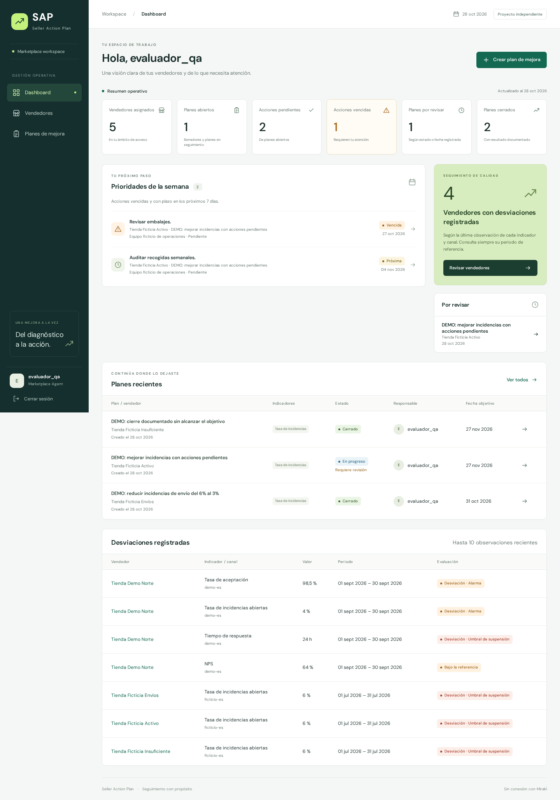

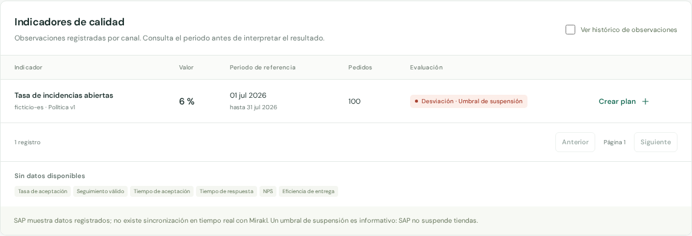

Se registran una acción correctiva de preparación y expedición y otra preventiva de control. Tras activar el plan, la primera se completa con fecha y evidencia. La segunda permanece pendiente deliberadamente. Se registra una revisión de agosto del 4,5% y otra de septiembre del 3%, ambas con cien pedidos; el autor y la fecha de registro los conserva el sistema.

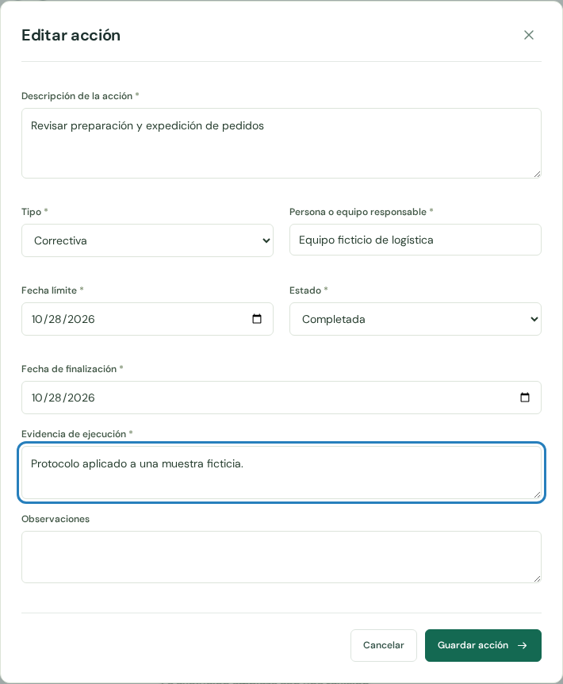

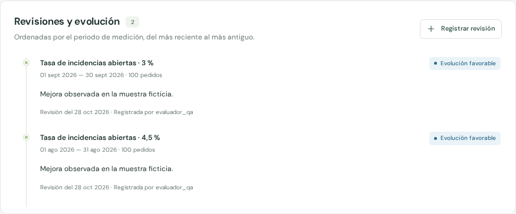

En incidencias, disminuir es mejorar. El 4,5% mejora respecto al 6%, pero no alcanza el objetivo del 3%; el 3% sí lo alcanza por igualdad. La clasificación informativa de calidad y el logro de la meta son cálculos relacionados pero distintos. La valoración escrita por el agente no sustituye esas comparaciones.

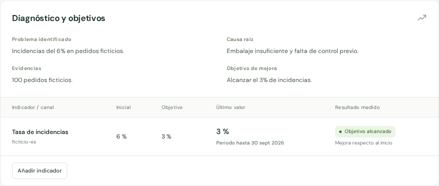

El cierre requiere razones y confirmación. Guarda `closure_evaluation.result=achieved` y conserva la acción preventiva pendiente. Después de recargar, el plan sigue cerrado y mantiene dos acciones y dos revisiones. Otro agente no puede consultarlo ni cerrarlo. El archivo de evidencia `react-django.json` guarda únicamente el endpoint y la evaluación ficticia, sin tokens ni cookies.

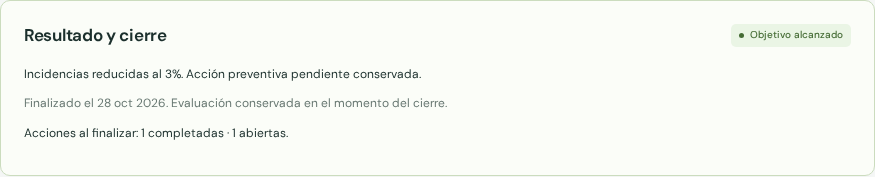

El caso demuestra funcionamiento de SAP, no un resultado conseguido por PcComponentes. No hay medición de pedidos reales ni conexión corporativa. La semilla y el recorrido permiten repetir el ejemplo con cuentas aisladas.

## 14. Limitaciones y mejoras futuras

El límite inmediato para entregar es la ausencia de una URL pública verificada. Existe una receta Render coherente con la arquitectura, pero faltan autorización de coste, provisión y acta de aceptación. El vídeo real tampoco está grabado y no se dispone de confirmación administrativa. Estos pendientes son obligatorios para declarar finalizada la fase.

El producto registra observaciones manuales, no calcula métricas desde pedidos. Su convención de ventana mensual está documentada en `docs/dominio.md`; no se presenta como reproducción certificada del algoritmo interno de Mirakl. Las revisiones no actualizan observaciones globales. No hay adjuntos, correo, roles externos ni registro universal de auditoría.

Como evolución posible, después de validar utilidad con usuarios, podrían estudiarse importación autorizada desde Mirakl API, notificaciones, informes, automatización de seguimientos y analítica. Son propuestas no implementadas. Una integración exigiría revisar procedencia, permisos, periodos, duplicados y límites operativos antes de ampliar el esquema. Ninguna de estas mejoras se trata como requisito añadido de aprobación.

## 15. Conclusiones

SAP aborda una necesidad concreta: relacionar desviaciones de calidad con decisiones y acciones de mejora que puedan revisarse. El producto desarrollado permite seguir ese ciclo de principio a fin y conservar el contexto de la decisión de cierre. Su aportación esperada es organizativa y de trazabilidad; el impacto profesional cuantitativo queda por medir.

El trabajo demuestra integración de Django y React, diseño relacional, validación de reglas, autorización por objeto y operación, pruebas y preparación de despliegue. La comprobación con PostgreSQL permitió distinguir transacciones, bloqueo de filas, edición obsoleta e idempotencia, en lugar de atribuir todas esas garantías a un único mecanismo.

El aprendizaje técnico debe poder explicarse desde el código: dónde se autoriza, qué se valida, cómo se evalúa y qué sucede ante un error. La defensa preparada propone preguntas y puntos de navegación para que el autor los ensaye con sus propias palabras. Los materiales de apoyo no sustituyen su comprensión ni acreditan autoría por sí mismos.

La memoria documenta una aplicación funcional y comprobada localmente. Para culminar la entrega es necesario publicar y verificar el servicio, grabar el vídeo de hasta cinco minutos, confirmar requisitos académicos y revisar los enlaces finales. La transparencia sobre estos límites forma parte del rigor del proyecto.

## Anexo A. Evidencias de interfaz

Las siguientes capturas se tomaron durante la misma QA local, con datos ficticios. Se conservan los originales PNG y un índice con su procedencia. Las imágenes de móvil documentan emulación de 390 px, no una prueba sobre un dispositivo físico.

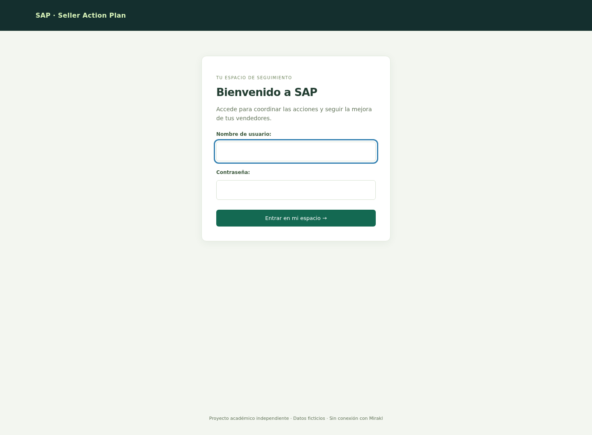

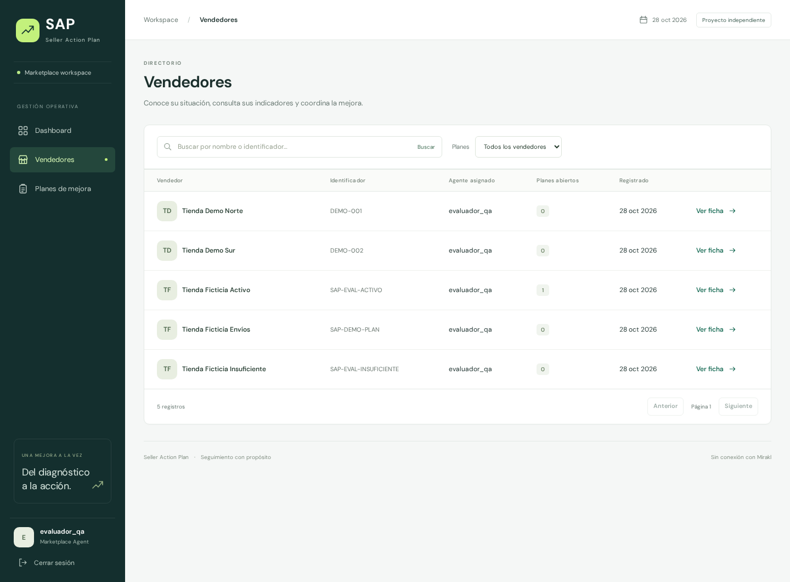

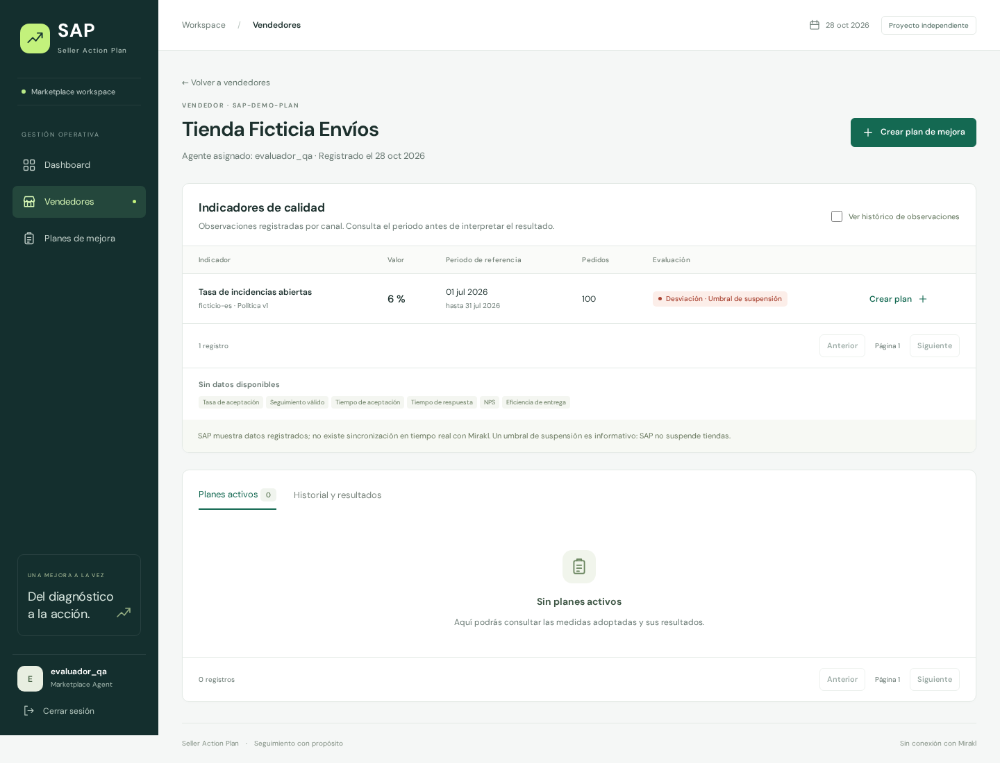

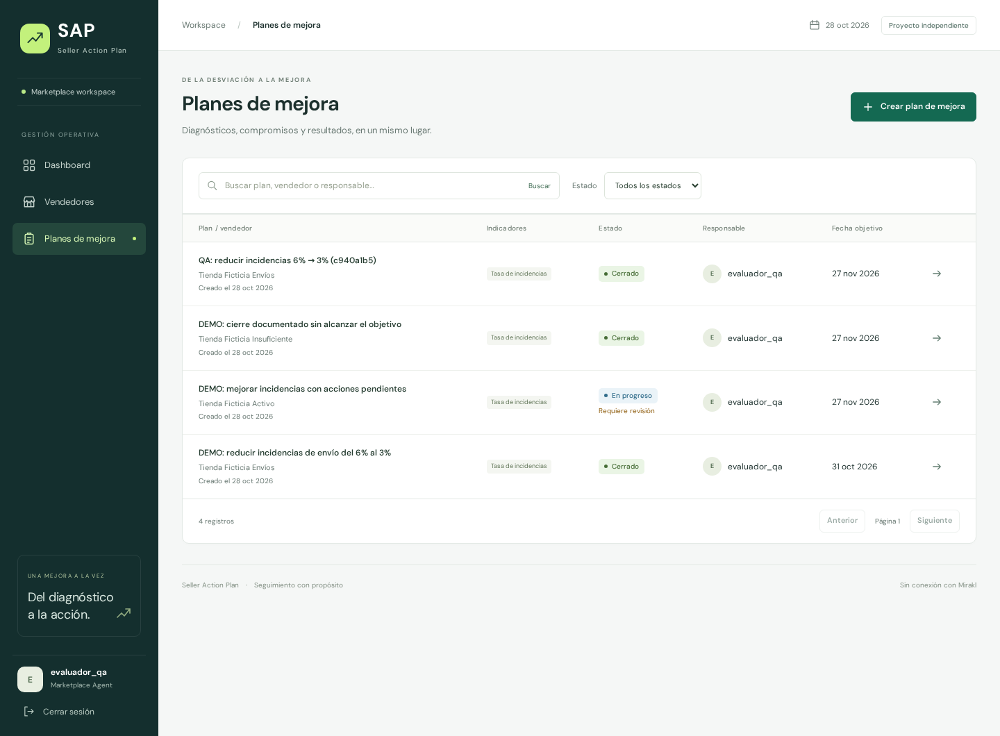

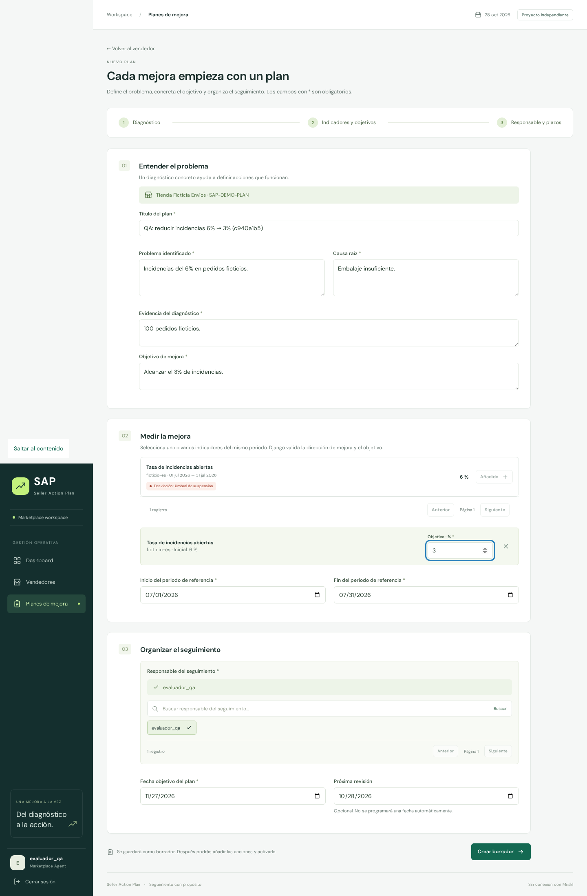

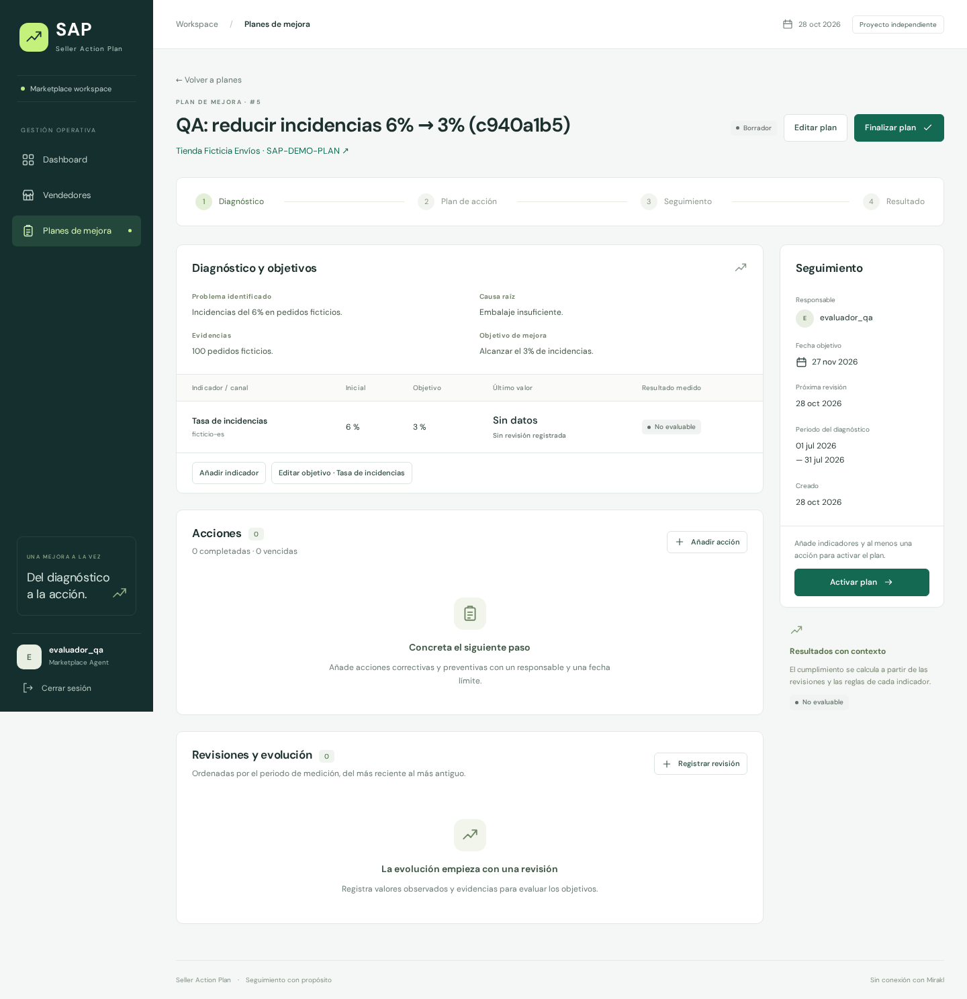

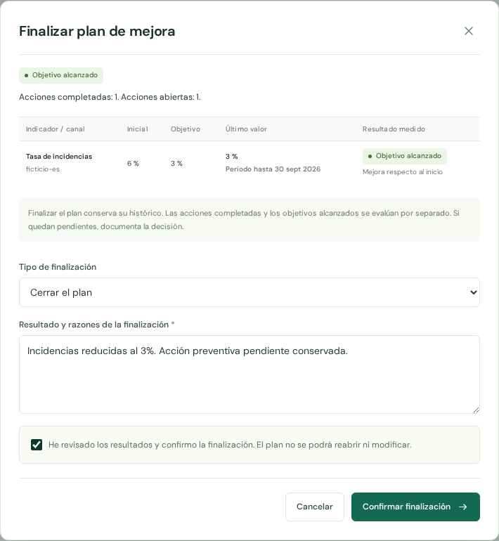

## Anexo B. Referencias y acceso a evidencias

La fuente académica obligatoria es [FS Proyecto Final - Máster en Desarrollo Full Stack](https://docs.google.com/document/d/1KhmvNgC4g9WI8suPOBjGFcUCQeA8rVPkoVS53fYLOkQ/edit), consultada el 28/10/2026. Su identificación, condiciones y contraste están en `docs/fuentes-pfm.md`; la matriz completa se encuentra en `docs/trazabilidad-requisitos.md`.

Código público: [Seller Action Plan en GitHub](https://github.com/Pablorossl/Seller-Action-Plan-SAP-). Verificación remota de código: [CI de Fase 3](https://github.com/Pablorossl/Seller-Action-Plan-SAP-/actions/runs/40747706230). La documentación de Fase 4 permanece local hasta un push autorizado. **Aplicación pública: pendiente. Vídeo: pendiente.** No se presentan enlaces de ejemplo como entregables existentes.

Referencias del repositorio: `backend/action_plans/models.py`, `services.py`, `views.py`, `concurrency.py`; `backend/quality/rules.py` y `services.py`; `backend/sellers/models.py`; `backend/config/settings.py`; `frontend/src/services/api.js`; `frontend/src/pages/`; `scripts/verify_browser.py`; `scripts/verify_phase3.py`. Informes históricos: `docs/fase-1.md`, `docs/fase-2.md`, `docs/fase-3.md`.

Operación propuesta: [Blueprint Render](https://render.com/docs/blueprint-spec), [precios](https://render.com/pricing), [backups](https://render.com/docs/postgresql-backups) y `docs/despliegue.md`. La continuidad y recuperación reales se registrarán en `docs/verificacion-publica.md` cuando exista infraestructura autorizada.
