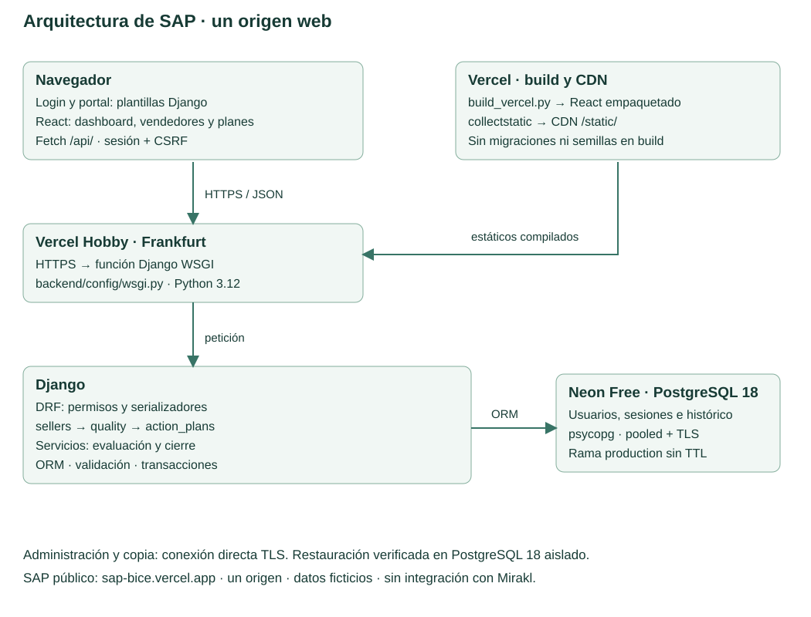
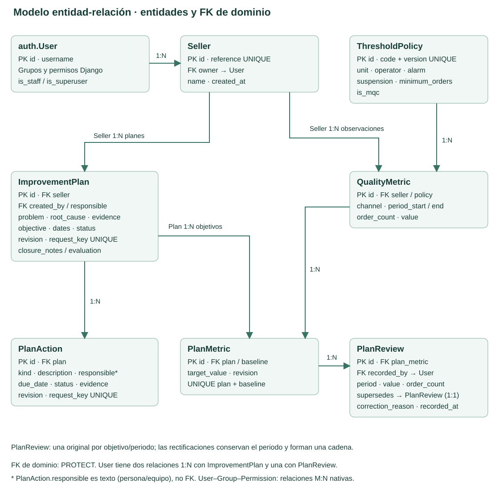
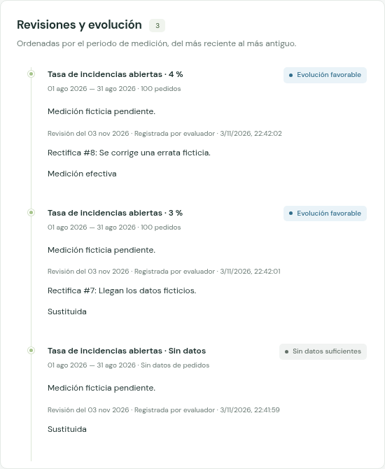
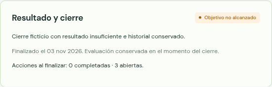
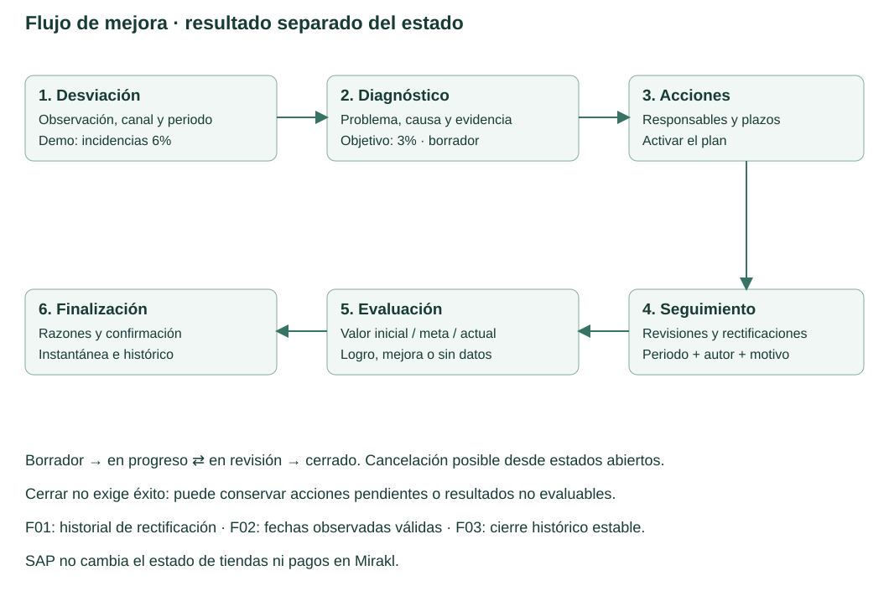
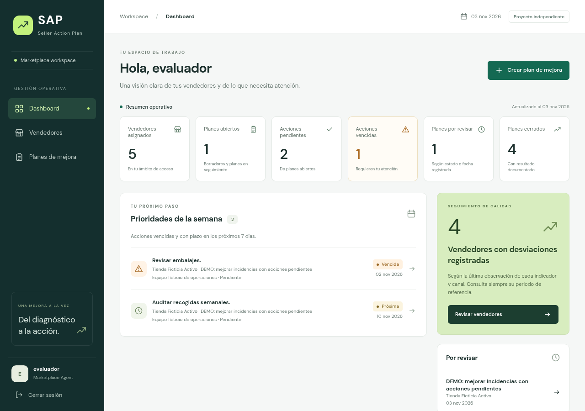
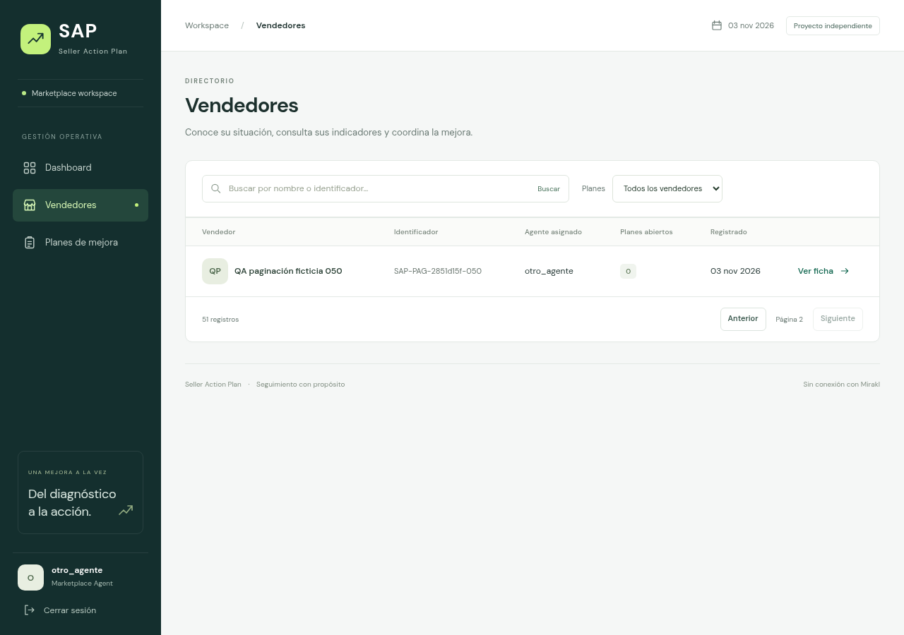
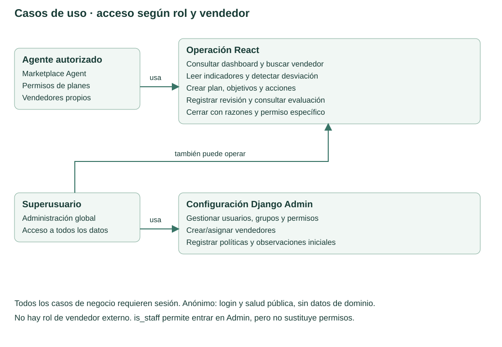
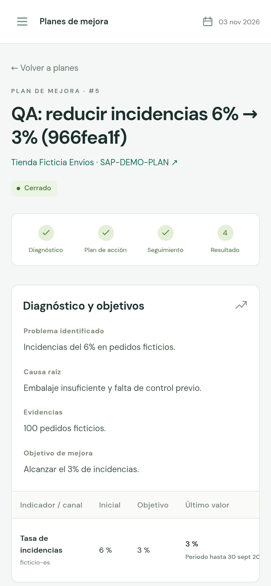

# Seller Action Plan (SAP)

**Memoria del Proyecto Final de Máster en Desarrollo Full Stack**

ConquerBlocks · **Pablo Rosales**

Revisión académica final · noviembre de 2026

Aplicación: [sap-bice.vercel.app](https://sap-bice.vercel.app)

Código desplegado: **97b4bff55a07b8fd3c71b05740748db5bf63438b**.

Documentación pública posterior: **575c6c942318885d6b7427ccedabc1eea7cc5887**. Esta revisión de memoria y sus exportaciones son cambios locales posteriores, todavía sin publicar.

La publicación y la aceptación técnica están verificadas. El vídeo, la comprobación de su enlace, la entrega formal y la defensa personal siguen pendientes. Esta memoria no atribuye una nota ni acredita el expediente académico.

Proyecto académico independiente para Account Managers y Marketplace Support Agents. No es una herramienta oficial de PcComponentes o Mirakl. Todos los datos de demostración son ficticios.

## Resumen ejecutivo

Seller Action Plan organiza el trabajo posterior a detectar una desviación de calidad de un vendedor de marketplace. Una cifra aislada no explica qué decisión se tomó, quién debe actuar, qué evidencia se conserva ni por qué se dio por terminado el seguimiento. SAP relaciona vendedores, observaciones, diagnósticos, objetivos, acciones y revisiones en un proceso consultable y protegido por permisos.

El backend Django conserva las reglas, la autenticación, las plantillas, la API y la persistencia; React ofrece el espacio de trabajo del agente y obtiene datos reales del servidor. PostgreSQL mantiene usuarios, sesiones e histórico. La aplicación se publica en Vercel Hobby y utiliza Neon Free, sin servicios de pago añadidos. El despliegue validado corresponde al SHA 97b4bff; el commit documental 575c6c9 registra evidencias posteriores y no debe confundirse con el código servido.

La aceptación pública reprodujo un ciclo ficticio de incidencias del 6 % al 4,5 % y al 3 %, con acciones, evaluación y cierre. También verificó rectificaciones con historial, rechazo de fechas futuras, CSRF y denegación entre agentes. Un redespliegue del mismo candidato conservó registros y sesión. Una copia de Neon se restauró en PostgreSQL 18 aislado: coincidieron datos y esquema de 21 tablas. Las comprobaciones adicionales de filtros y paginación se documentan por separado con registros ficticios temporales.

Estos resultados acreditan comportamientos técnicos en los entornos descritos. No constituyen una medición de ahorro de tiempo, productividad, satisfacción o impacto económico. La utilidad profesional propuesta debe validarse con usuarios y un procedimiento específico antes de cuantificar beneficios.

## 1. Problema, contexto y necesidad

Los equipos de atención y gestión de vendedores necesitan convertir indicadores de calidad en decisiones de seguimiento. Consultar una tasa de incidencias o un tiempo de respuesta permite identificar una señal, pero no garantiza que el diagnóstico, las acciones y las revisiones queden relacionados. Si esa información se reparte entre notas y conversaciones, reconstruir el estado de un caso exige buscar su contexto y distinguir acuerdos, tareas y resultados.

SAP aborda esa discontinuidad documental. Su unidad de trabajo es un plan asociado a un vendedor y a una o varias observaciones iniciales. El agente registra el problema, la causa, la evidencia disponible y una meta; después concreta acciones y revisa mediciones posteriores. El cierre conserva las razones y la evaluación del momento, incluso cuando la meta no se ha alcanzado.

El contexto profesional procede del ámbito de Marketplace Support que presenta el autor. La necesidad se formula como análisis del proceso, no como conclusión de entrevistas, una encuesta o una investigación empresarial ejecutada. No se aportan registros corporativos ni se afirma que una organización haya adoptado SAP.

Mirakl y las fuentes públicas sobre calidad sirven de contexto. SAP no consulta sus pedidos, no modifica tiendas, no emite sanciones y no reproduce una integración con esas plataformas. Las políticas de calidad guardadas representan reglas explícitas de esta aplicación; no se anuncian como una actualización automática de las condiciones de un tercero.

## 2. Objetivos, alcance y criterios de éxito

El objetivo general es construir y explicar una aplicación Full Stack que transforme una desviación registrada en un proceso de mejora trazable, persistente y autorizado por cartera de vendedores.

Los objetivos específicos son conservar el diagnóstico y sus metas, asignar responsables y plazos, registrar mediciones sin destruir las anteriores, distinguir tareas de resultados, impedir accesos entre carteras y comprobar la conservación del histórico al cerrar, redesplegar y recuperar una copia.

El MVP incluye login y logout, dashboard, búsqueda y filtros, directorio y ficha de vendedores, políticas versionadas, observaciones globales, planes con varios objetivos, acciones, revisiones, rectificaciones y cierre. La API permite altas de vendedores propios; React se concentra en consultar vendedores y gestionar el seguimiento. La configuración de políticas, observaciones y asignaciones se realiza mediante administración autorizada.

Quedan fuera integración con marketplaces, cuentas de vendedores externos, correo, adjuntos binarios, sanciones, pagos, inteligencia artificial y exportaciones del producto. El exportador de esta memoria es una herramienta documental local y no una funcionalidad de SAP.

El criterio técnico de éxito es reproducir el ciclo con datos persistidos, ver errores de validación y permisos, mantener los registros tras un redespliegue y recuperar una copia sin sobrescribir Production. Los criterios académicos incluyen también documento, vídeo y comprensión personal; la publicación por sí sola no completa la entrega.

## 3. Aportación y reflexión sobre eficiencia

La aportación de SAP consiste en reunir el contexto del indicador y el seguimiento del plan, manteniendo una relación explícita entre cada medición y la decisión de cierre. La interfaz muestra qué se sabe, qué falta y qué registro está vigente, sin convertir una valoración del agente en un resultado numérico favorable.

| Proceso | Capacidad implementada | Alcance de la evidencia |
| --- | --- | --- |
| Localizar una cartera | Búsqueda, filtros y paginación autorizados | Comprobación pública; no estudio de tiempos de agentes |
| Preparar un seguimiento | Diagnóstico, metas, responsables y plazos relacionados | Formularios, reglas y persistencia verificadas |
| Comparar mediciones | Evaluación del valor inicial, meta y revisión efectiva | Ejemplos ficticios reproducidos mediante API e interfaz |
| Corregir una captura | Nueva revisión enlazada, motivo, autor y fecha | Cadena histórica pública conservada |
| Justificar una finalización | Razones e instantánea de evaluación | Cierre y recuperación verificados |

Se espera reducir la dispersión de información y facilitar la preparación de seguimientos. No se han medido minutos ahorrados, reducción de errores humanos, satisfacción ni retorno económico. El cambio ficticio del 6 % al 3 % ilustra una regla de evaluación; no es una mejora real obtenida en un marketplace.

Una validación posterior podría comparar un escenario equivalente con y sin SAP, definir participantes y tareas, registrar tiempo y errores de recuperación del histórico y recoger dificultades de uso. Haría falta controlar el aprendizaje, describir la muestra y reconocer sus límites. Esta propuesta no se presenta como investigación ya realizada.

La eficiencia técnica también tiene límites: la paginación evita devolver todo un listado y las precargas reducen consultas repetidas, pero no se ha ejecutado una prueba de carga representativa de producción. La evidencia disponible permite defender coherencia e integridad, no capacidad ilimitada.

## 4. Tecnologías y decisiones justificadas

| Tecnología | Uso efectivo y justificación |
| --- | --- |
| Python 3.12 y Django 5.2.18 | Modelos, ORM, migraciones, vistas, plantillas y autenticación integrados; backend exigido por la guía |
| Django REST Framework 3.18.3 | Serializadores, permisos, validación de API y paginación; contrato JSON consumido por React |
| React y React DOM 19.3.1 | Dashboard, listados y formularios operativos con datos reales del backend |
| JavaScript, HTML y CSS | Interacción, estructura de interfaz, estados de carga/error y adaptación a móvil |
| Vite 7.3.7 y Node 22.x | Compilación del frontend; Node no sustituye al runtime Python de Django |
| PostgreSQL 18 y psycopg 3.3.6 | Persistencia externa al proceso web, transacciones y bloqueo de filas |
| django-environ y tzdata | Configuración por entorno y fechas coherentes con Europe/Madrid |
| django-axes | Límite persistente de intentos de login en PostgreSQL, sin añadir Redis |
| Vercel Hobby y Neon Free | Función Django, CDN y base persistente para la demostración académica gratuita |
| Git, GitHub y Actions | Historial progresivo y CI del SHA exacto publicado |
| Playwright, Chromium y clientes PostgreSQL 18 | Pruebas y exportación documental; herramientas de QA fuera del runtime |

Las versiones proceden de los archivos fijados del candidato y de los entornos comprobados. La CI utiliza PostgreSQL 16, mientras que Neon y la restauración usan 18; no se trata de la misma prueba. SQLite sigue disponible para desarrollo sencillo, pero no acredita bloqueos concurrentes de PostgreSQL.

Gunicorn, WhiteNoise y la receta Render pertenecen a ejecución local o antecedentes conservados. En el despliegue entregado, Vercel ejecuta WSGI y sirve los estáticos recogidos desde su CDN. No se utiliza Gunicorn como comando de arranque en Vercel ni se ha contratado Render.

Se mantiene un solo origen para acceso, dashboard y API. Con ello se aprovechan sesiones y CSRF de Django y se evita añadir una arquitectura de autenticación distribuida que el alcance no necesita. No se requiere un dominio comprado ni Docker; la guía los permite como decisiones técnicas, no los impone.

## 5. Usuarios, permisos y límites de acceso

| Actor | Acciones permitidas | Límite relevante |
| --- | --- | --- |
| Visitante sin sesión | Acceder al login y consultar salud sin datos de negocio | Dashboard redirige al acceso y API de dominio deniega la petición |
| Usuario autenticado sin rol | Mantener una sesión de Django | La sesión no concede por sí sola permiso de marketplace |
| Agente autorizado | Consultar vendedores propios y ejecutar operaciones de seguimiento concedidas | La cartera se deriva del propietario del vendedor y cada operación exige permisos |
| Agente con acceso a Admin | Entrar en las funciones administrativas expresamente concedidas | is_staff habilita entrada, no acceso global ni todos los permisos |
| Superusuario | Configurar usuarios, grupos, políticas, observaciones y asignaciones globales | Cuenta privilegiada, no utilizada como cuenta de evaluación |

Las dos cuentas de evaluación son agentes no administrativos. El vendedor externo no es un usuario del MVP. El campo responsable de un plan describe el trabajo, pero no concede acceso automáticamente; la propiedad del vendedor determina la cartera visible. Una reasignación administrativa transfiere ese acceso y conserva la autoría histórica.

La autorización se ejecuta en el backend. Ocultar botones evita confusión, pero no sustituye IsMarketplaceAgent, visible_sellers, visible_plans y los permisos específicos. Tampoco basta con conocer el ID de un plan: las consultas de detalle y las referencias de los formularios se limitan al ámbito autorizado.

## 6. Casos de uso representativos

### CU01. Acceder y cerrar sesión — visitante y agente

El visitante abre el login, introduce sus credenciales por un canal seguro y Django autentica la cuenta. El resultado correcto es una sesión y el dashboard; una contraseña incorrecta no habilita acceso y los intentos repetidos se limitan. El agente sale mediante POST con CSRF. Tras salir, la API de dominio vuelve a denegar el acceso. El resultado del navegador se comprobó públicamente; el bloqueo repetido se cubre además por pruebas de configuración.

### CU02. Localizar un vendedor — agente

El agente abre su directorio, busca una referencia o aplica el filtro de planes abiertos. La API devuelve una página de su cartera y React representa sus filas. El resultado es una ficha autorizada con indicadores y planes. Una búsqueda sin coincidencias muestra un estado vacío; un ID ajeno devuelve 404. La paginación se contrastó con resultados reales de servidor y navegación Siguiente/Anterior, no con respuestas simuladas.

### CU03. Crear el diagnóstico — agente con permisos

Desde una observación válida del vendedor, el agente define problema, causa, evidencia, objetivo y fechas. Django valida pertenencia, periodo y meta y guarda plan y objetivos en una transacción. En el ejemplo, una meta del 7 % para incidencias iniciales del 6 % es rechazada; la meta del 3 % sí es válida. Una observación futura no puede usarse como diagnóstico. Un error se presenta en el formulario y no obliga a perder el contenido introducido.

### CU04. Gestionar acciones — agente con permisos

El agente añade una acción correctiva o preventiva, su responsable textual y plazo, activa el plan y registra su ejecución. Completar una acción exige la información de finalización y evidencia correspondiente. El resultado es un compromiso persistido, separado de la medición del objetivo. Una fecha incompatible, una edición obsoleta o un plan finalizado impiden guardar el cambio por las rutas soportadas.

### CU05. Revisar y rectificar — agente con permisos

Se añade una medición posterior con periodo, pedidos cuando proceden y comentario. Si falta una medición, SAP muestra que no es evaluable. Una rectificación crea otra revisión vinculada a la anterior y exige motivo; conserva objetivo y periodo. El resultado es una cadena consultable con autor y fecha, sin sobrescribir registros. Se rechazan duplicados, fechas futuras, ramificaciones y rectificaciones de planes finalizados.

### CU06. Evaluar y cerrar — agente con permiso de cierre

La API compara observación inicial, objetivo y medición efectiva. El agente revisa el resultado, aporta razones y confirma la finalización. Django conserva una instantánea y retira las operaciones de edición del flujo. Cerrar no exige éxito ni completar todas las tareas: el ejemplo puede concluir como no alcanzado o no evaluable. Un cierre sin confirmación o razones, sin permiso o sobre un plan ya finalizado se rechaza.

### CU07. Configurar el ámbito — administrador

El administrador mantiene usuarios, permisos, vendedores y políticas mediante Django Admin autorizado. Las asignaciones controlan la cartera y las políticas versionadas conservan la referencia histórica. La operación correcta deja relaciones válidas y auditables; datos incompatibles muestran errores de validación. Esta capacidad se contrastó con código y pruebas de Admin; no se entregó una cuenta privilegiada ni se expuso Admin durante la aceptación de agentes.

### CU08. Recuperar una copia — responsable técnico

El responsable exporta una copia consistente por conexión directa y la restaura en una base aislada compatible. Después compara esquema, datos de control y lectura funcional. El resultado verificado fue una restauración PostgreSQL 18 con 21 tablas coincidentes. Una versión incompatible del cliente o una discrepancia debe detener la aceptación de esa copia. Nunca se prueba la restauración encima de Production.

## 7. Arquitectura e integración Django–React

SAP es un monolito modular. Las aplicaciones sellers, quality y action_plans separan vendedores, observaciones y seguimiento; config reúne rutas y ajustes. Esa organización mantiene las reglas cerca de los datos sin introducir comunicación entre varios servicios de negocio.



El login y el portal son plantillas Django. La vista protegida dashboard renderiza el índice compilado de React. La navegación usa fragmentos como #/sellers y #/plans/6, de modo que Django conserva el control de entrada y React gestiona las vistas operativas.

Una lectura típica empieza en frontend/src/pages/PlanDetail.jsx. Fetch solicita /api/plans/6/ en el mismo origen con la cookie de sesión. DRF autentica, exige permisos y filtra por vendedores visibles. El ORM obtiene las relaciones y el serializador devuelve el estado y su evaluación; React representa la respuesta. La interfaz no decide por su cuenta que un objetivo se ha alcanzado.

En una escritura, frontend/src/services/api.js añade la cabecera X-CSRFToken. La vista valida la solicitud, las relaciones y la operación; los modelos y servicios aplican las reglas de negocio dentro de la transacción. El cliente utiliza la respuesta persistida y muestra errores de campo, conflictos o fallos de conexión. No se necesita CORS para este despliegue del mismo origen.

El build compila React, lo copia a backend/frontend_dist y permite a Vercel ejecutar collectstatic. El CDN publica los assets; la función WSGI ejecuta Django. Ni el build ni la importación de WSGI migran, crean cuentas o cargan semillas. La base no reside en el disco efímero de la función.

## 8. Modelo de datos e integridad



| Entidad | Responsabilidad principal |
| --- | --- |
| auth.User | Identidad, grupos y permisos nativos Django; autores y responsables relacionados |
| Seller | Referencia única, nombre y propietario de la cartera |
| ThresholdPolicy | Código y versión, unidad, dirección, límites y condiciones de evaluación |
| QualityMetric | Observación de vendedor y política con canal, periodo, pedidos y valor |
| ImprovementPlan | Diagnóstico, fechas, estado, autor, responsable, revisión y cierre |
| PlanMetric | Objetivo que une el plan con su observación inicial protegida |
| PlanAction | Compromiso, responsable textual, plazo, estado y evidencia de ejecución |
| PlanReview | Medición histórica, autor, fecha y posible vínculo con la revisión que rectifica |

Las FK de dominio protegidas evitan borrar referencias necesarias para explicar el histórico. Las restricciones de PostgreSQL cubren unicidad y coherencia estructural; clean y save añaden validaciones de dominio que dependen de otras entidades o de la fecha actual. No se supone que toda regla esté expresada como una restricción SQL.

Las escrituras del seguimiento bloquean primero el vendedor autorizado y después el plan, dentro de transaction.atomic. Los hijos y el cierre comparten ese ámbito. revision detecta formularios obsoletos y produce conflicto; las claves de idempotencia de creación de planes y acciones permiten reconocer un reintento del mismo contenido. Son mecanismos distintos. Los clientes que omiten revisión o clave no reciben todas sus garantías adicionales.

El acceso SQL privilegiado, QuerySet.update y bulk_create pueden eludir validaciones de modelo. No son vías de entrada del producto ni deben emplearse como atajo de importación. La aplicación no afirma inmutabilidad criptográfica de toda la base.

## 9. F01–F03: correcciones y conservación del significado

### F01. Rectificación sin pérdida de historial

Cada corrección es una PlanReview nueva. supersedes apunta a la revisión efectiva anterior; correction_reason exige el motivo y recorded_at conserva el instante de alta. El autor se obtiene de la sesión. Objetivo y periodo no cambian dentro de una cadena. La unicidad parcial conserva una original por objetivo/periodo y la relación uno a uno evita dos sucesoras del mismo registro.

La evaluación elimina primero las revisiones sustituidas y elige después el periodo efectivo más reciente. Corregir un periodo antiguo no desplaza por fecha de captura una medición posterior. La interfaz identifica registros sustituidos y efectivos, junto con vínculo, motivo, autor y fecha. El permiso sigue siendo añadir revisión; el agente no puede editar la fila original.



La migración 0003 incorporó los campos y la restricción parcial sin una operación de modificación de datos. En Production está aplicada junto con las otras 32 migraciones; no volvió a ejecutarse durante la publicación ni durante esta preparación académica.

### F02. Observaciones y revisiones con fechas válidas

Las fechas de observación no pueden superar la fecha local de Europe/Madrid. Hoy es admisible; exigir un mes completo para evaluar determinados indicadores es otra regla. Las fechas previstas de acciones y planes sí pueden estar en el futuro.

La selección de la observación actual excluye periodos futuros antes de elegir la última observación. Los registros futuros heredados permanecen en el histórico, identificados y no evaluables, en lugar de borrarse o esconder la observación válida anterior. Tampoco se permite utilizarlos como base de un objetivo nuevo. No se añadió una migración de limpieza automática.

La API de observaciones globales es de solo lectura. La aceptación pública comprobó el rechazo de revisiones y periodos futuros; los casos de observaciones heredadas, Admin y fronteras de fecha tienen evidencia de código y pruebas locales/CI. No se afirma haber introducido datos futuros inválidos en Production para ensayarlos.

### F03. Estado histórico al finalizar

El cierre conserva la evaluación, el recuento de acciones y su situación de vencimiento en ese momento. La consulta posterior de un plan finalizado utiliza esa instantánea en vez de recalcular el pasado con la fecha del día. Cuando un cierre antiguo no guardó un detalle, la aplicación muestra desconocido y no inventa una reconstrucción.



En el plan 6 se verificó una acción vencida al cierre y otras dos no vencidas. Esa información sobrevivió al redespliegue. El calendario se avanzó noventa días únicamente en la base restaurada aislada, donde la lectura Django conservó la misma evaluación y los mismos indicadores históricos. No se cambió el reloj del servicio público ni se modificaron sus fechas para producir la evidencia.

## 10. Seguridad y protección de datos

La autenticación utiliza contraseñas con los hashers de Django y sesiones persistidas en PostgreSQL. React no almacena contraseñas ni un token de acceso de larga duración. Las dos cuentas de evaluación no tienen privilegios administrativos; sus credenciales se custodian fuera de Git y de los entregables.

| Riesgo | Control implementado y evidencia |
| --- | --- |
| Acceso a cartera ajena | Rol, permisos por operación y consultas filtradas por propietario; lectura y cierre ajenos devolvieron 404 |
| Escritura inducida desde otro origen | CSRF de Django; pruebas públicas sin token y con origen ajeno rechazadas |
| Manipulación de relaciones | Querysets autorizados y autor/propietario impuestos por el servidor |
| XSS e inyección | Texto escapado por React/plantillas y ORM parametrizado; no se interpreta HTML del usuario |
| Intercepción de sesión | HTTPS, cookies Secure, sesión HttpOnly y SameSite=Lax; cabeceras de seguridad verificadas |
| Intentos de login repetidos | Django-axes persistido por usuario, con pruebas de bloqueo y rotación de señales cliente |
| Pérdida o sobrescritura de histórico | Validación, transacciones, bloqueos, revisiones enlazadas e instantánea de cierre |
| Exposición de secretos y copias | Variables Production privadas, archivos locales excluidos de Git y directorios de custodia restringidos |

En Vercel, settings.py utiliza las variables del proyecto y no lee el .env local. DEBUG está desactivado, los hosts y orígenes CSRF son exactos y PostgreSQL requiere TLS. Se reconoce el protocolo del proxy de Vercel y no se confía en un Host reenviado arbitrario. El endpoint de salud devuelve estado mínimo, sin configuración ni registros de negocio.

Las medidas se comprobaron mediante pruebas y recorrido público, no mediante una auditoría de penetración completa. Persisten riesgos de acceso privilegiado a la base, denegación temporal por bloqueo de una cuenta atacada, errores operativos de configuración y dependencia de proveedores. No se declara certificación de seguridad, accesibilidad o cumplimiento legal.

Los datos usados en capturas y aceptación son ficticios. Una copia de seguridad puede contener hashes de contraseña y sesiones; por ello permanece privada y no acompaña al PDF, Word o repositorio. Las evidencias públicas muestran resultados, no contraseñas, cookies, claves ni cadenas de conexión.

## 11. Implementación y recorrido de datos



La evolución del repositorio conserva base Django/React, gestión de planes, interfaz operativa, controles de concurrencia y correcciones posteriores. F01–F03 son decisiones de integridad de SAP que refuerzan el proceso; la guía no exige nominalmente esos tres identificadores.

| Hito | Referencia conservada |
| --- | --- |
| Base Django/React | f844974 |
| Planes y dominio | 39a6d07 |
| Interfaz operativa | 0ec5a25 |
| Seguridad, PostgreSQL y concurrencia | 49ee198 |
| Preparación Vercel/Neon | 54ac2cd |
| Rectificaciones, fechas y cierre histórico | 160fc4c |
| Candidato desplegado y aprobado | 97b4bff |
| Acta y evidencias posteriores | 575c6c9 |

El flujo central comprobado parte de una observación ficticia del 6 % y una meta del 3 %. La revisión del 4,5 % representa mejora respecto al inicio, pero no alcanza esa meta. La revisión del 3 % sí la alcanza. Una tarea pendiente no se transforma en completada al cerrar y una valoración narrativa del agente no sustituye a la comparación numérica.

Una selección de campos comprobados del plan público 5 ilustra el resultado; no es la respuesta completa de la API:

```json
{
  "id": 5,
  "status": "closed",
  "closure_evaluation": {"result": "achieved"}
}
```

El plan 6 muestra el caso complementario: una corrección cambia la medición efectiva al 4 % y el resultado es no alcanzado. Mantener ambos ejemplos evita confundir la finalización administrativa con un éxito impuesto por el sistema.



## 12. Estrategia de pruebas y resultados observados

| Entorno | Evidencia realmente disponible | Qué no demuestra por sí solo |
| --- | --- | --- |
| Pruebas de configuración y frontend | Siete pruebas Django de configuración y ejecución node:test aprobadas antes del candidato | Todos los escenarios de usuario en producción |
| CI de 97b4bff | Workflow aprobado con checks, build, SQLite y PostgreSQL 16 | Que Neon sea PostgreSQL 16 o que el servicio no pueda caer |
| Chromium público | Login, flujo central, errores, CSRF, permisos, recarga y móvil a 390 px | Uso desde un dispositivo físico o una segunda red independiente |
| Aceptación F01–F03 | Historial, rechazo de futuras, cierre y bloqueo de cambios posteriores | Escrituras SQL privilegiadas fuera de las rutas soportadas |
| Redespliegue del candidato | JSON íntegro de planes de control y sesión conservados | Migración hacia una versión futura incompatible |
| Restauración aislada PostgreSQL 18 | Datos y esquema coincidentes; lectura funcional e histórico con calendario avanzado | Un servicio de copias automáticas o PITR de varios días |

El acta de publicación identifica planes 5 y 6 y los dos deployments del mismo SHA. El primero procede de una copia exacta del commit; el final se generó desde Git tras corregir el permiso de la GitHub App y la conexión al repositorio ID 1430152684. El alias fue comprobado antes y después.

La preparación académica completó filtros de vendedores por planes abiertos y filtros de planes por estado, contrastando interfaz y API. Para la paginación se utilizaron registros ficticios temporales del segundo agente hasta disponer de 51 vendedores: dos páginas reales de 50 y 1 resultados. Se comprobaron límites, ausencia de duplicados, navegación, reinicio de página al filtrar/buscar y aislamiento. Se eliminaron solo los registros creados para la prueba y se verificó la conservación de los existentes. El JSON específico registra el resultado y su alcance; no representa una simulación con datos interceptados.



La navegación entre dos páginas se ejercitó en vendedores, que comparte el componente Pagination con otros listados. Los filtros de planes se probaron con sus registros existentes; no se generaron veintiún planes únicamente para forzar una segunda página. Esa distinción limita correctamente la cobertura afirmada.

Las cifras de 77, 110 o 112 pruebas de informes anteriores identifican ejecuciones históricas diferentes, algunas con clases heredadas. No se suman ni se presentan como nuevos casos independientes. Para el candidato entregado se cita la CI de su SHA exacto y los resultados de los recorridos ejecutados.

## 13. Despliegue real y operación gratuita

La URL pública es [https://sap-bice.vercel.app](https://sap-bice.vercel.app). El código servido corresponde a 97b4bff55a07b8fd3c71b05740748db5bf63438b y el deployment final es dpl_DVtuHFEv9eTba7V8ShdLASR9BBTi. La documentación posterior está en 575c6c942318885d6b7427ccedabc1eea7cc5887; esta actualización académica todavía es local. Ninguno de esos identificadores se intercambia por la etiqueta ambigua «última versión».

Vercel utiliza preset Django, raíz backend, acceso al frontend situado fuera de esa raíz, build python build_vercel.py y función WSGI en Frankfurt. El builder instala dependencias, compila React y recoge estáticos. En el deployment final se confirmó Node 22.x; Python ejecuta Django. Los datos y las sesiones permanecen en Neon, no en el sistema de archivos de Vercel.

Neon utiliza el proyecto empty-feather-02803695 y la rama production, PostgreSQL 18. La rama es predeterminada y no tiene fecha de expiración. La aplicación usa DATABASE_URL pooled con TLS y psycopg, sin pool adicional local ni cursores que deban sobrevivir una transacción de PgBouncer. La conexión directa se reserva para administración y copias.

Las variables de Production comprenden secreto Django estable, conexión, hosts exactos, orígenes CSRF y desactivación explícita de DEBUG y modo demo. No se comparten secretos con Preview. El secreto se conserva entre los dos deployments; la continuidad de sesión también quedó comprobada. Ni esta memoria ni el repositorio contienen sus valores.

Vercel Hobby y Neon Free fueron confirmados al finalizar la publicación. No se añadieron medios de pago, pruebas de pago ni servicios contratados. La solución es adecuada para la demostración académica de bajo tráfico dentro de las condiciones y cuotas de esos planes. No se promete disponibilidad ilimitada: el autor debe revisar consumo, acceso y alojamiento durante la evaluación. Render permanece como antecedente, no como infraestructura vigente.

## 14. Persistencia, copias y recuperación

La comprobación de persistencia comparó los mismos IDs antes y después del redespliegue desde Git. Se conservaron el JSON completo del plan 6, sus acciones y revisiones, la instantánea y el aislamiento; el plan 5 mantuvo el resultado alcanzado. También sobrevivió la sesión. No se repitieron migraciones ni semillas para reconstruir ese estado.

Para recuperar una copia se empleó pg_dump 18.6, compatible con el servidor 18. El cliente 14 inicialmente instalado no era adecuado para exportarlo. Las herramientas necesarias se extrajeron temporalmente desde paquetes oficiales verificados, sin sustituir otros servicios del sistema.

Se exportó un snapshot repeatable-read de solo lectura a una copia privada. pg_restore creó su contenido exclusivamente en un PostgreSQL 18 local aislado, base sap_recovery_20261103. Coincidieron los conteos y huellas de las 21 tablas públicas, los índices, las restricciones y las 33 migraciones registradas. La aplicación Django pudo consultar los planes de control en esa base. El servidor temporal quedó detenido después.

La copia y las credenciales están fuera de Git y de los entregables, en ubicaciones privadas con directorios 0700 y archivos 0600. No se restauró sobre Production. La prueba acredita recuperación de ese snapshot en un destino aislado, no la existencia de backups programados, un objetivo RPO/RTO garantizado o una ventana ilimitada de restauración del proveedor.

## 15. Limitaciones y trabajo posterior

SAP no ha sido evaluada por una muestra de agentes en un estudio de utilidad. Los ejemplos son ficticios; el autor no atribuye mejoras económicas o de productividad a sus resultados. No hay integración de datos, correo de recuperación de contraseña, notificaciones ni adjuntos. El detalle de un histórico extenso no está paginado como los listados generales.

La validación de fechas y ciertas reglas entre entidades depende de las rutas de aplicación. Un acceso privilegiado directo puede eludirlas. Los escenarios de concurrencia probados no representan todas las intercalaciones posibles y las pruebas de seguridad no equivalen a una auditoría exhaustiva.

La comprobación desde una segunda red independiente continúa pendiente. Cambiar de sesión, agente o navegador en el mismo equipo no resuelve ese pendiente. Las capturas móviles corresponden a emulación, no a un dispositivo físico. La continuidad durante revisión y defensa sigue siendo una responsabilidad operativa del autor.

Las mejoras futuras razonables serían validar la utilidad con participantes, mejorar la navegación de históricos grandes y estudiar importaciones autorizadas que conserven procedencia y periodos. Son propuestas; no se han incorporado durante esta preparación. Antes de ampliar el producto debe definirse qué necesidad y prueba justifican cada cambio.

## 16. Conclusiones

SAP materializa un flujo de seguimiento coherente con Django y React: relaciona diagnóstico, compromisos y mediciones, conserva sus referencias y permite un cierre explicado. La separación entre tarea ejecutada, mejora observada, objetivo alcanzado y estado administrativo evita que la herramienta fabrique una conclusión favorable por el mero hecho de finalizar un caso.

F01 refuerza la trazabilidad de las correcciones; F02 protege el significado temporal de las observaciones; F03 conserva la situación histórica del cierre. La publicación, el redespliegue y la restauración aportan evidencia técnica concreta, con un SHA y entornos identificables. No sustituyen un estudio de impacto profesional ni la comprensión personal del código.

La memoria y sus materiales de apoyo preparan la entrega, pero quedan el vídeo real accesible de hasta cinco minutos, la revisión personal del autor y el procedimiento académico. La defensa debe explicar estas decisiones desde el código y reconocer los límites, sin memorizar afirmaciones que no se puedan justificar.

## Anexo A. Correspondencia con la guía académica

La guía original se releyó mediante Google Drive el 03/11/2026; su modificación indicada sigue siendo 08/10/2026. No se redistribuye una copia de la academia. La correspondencia se expresa en contenido propio de SAP:

| Apartado explícito | Cobertura en esta memoria |
| --- | --- |
| Problema y contexto | Resumen y secciones 1–2: necesidad, impacto potencial, solución y exclusiones |
| Aportación y eficiencia | Sección 3: capacidades observadas y beneficios esperados sin métricas inventadas |
| Tecnologías justificadas | Secciones 4 y 7–8: Django, React, base, librerías y decisiones de arquitectura |
| Tipos de usuarios | Sección 5: visitante, cuenta sin rol, agente y administración |
| Casos de uso | Sección 6: actores, flujo, resultado y errores; sección 11 para el recorrido central |
| Seguridad y protección de datos | Secciones 9–10 y 14: autenticación, validación, CSRF/XSS, hashing, secretos, HTTPS y copias |

Los mínimos técnicos se localizan en modelos, vistas y plantillas Django, autenticación y persistencia, vistas React con API real, URL pública y repositorio con README e historial progresivo. Las figuras incluyen arquitectura, entidades, flujo y capturas reales; el ejemplo de API se vincula a un caso comprobado.

Los cuatro elementos de entrega son repositorio, aplicación, memoria PDF o Word y vídeo con enlace accesible. Los tres primeros tienen material preparado o comprobado; el vídeo sigue sin grabar. La guía limita el vídeo a cinco minutos y la defensa a veinte. La rúbrica pondera backend 30 %, React 15 %, arquitectura 15 %, seguridad 15 %, documentación 15 % y reflexión 10 %; no se deriva una calificación de estas pruebas.

El autor debe contrastar las aprobaciones previas y la confirmación docente con sus justificantes. Una declaración previa no equivale a inspeccionar un expediente. Tras la revisión académica corresponde al equipo docente convocar la defensa. La memoria no afirma que se haya realizado una entrega formal o una evaluación.

## Anexo B. Evidencias visuales y acceso





Las capturas públicas de la aceptación inicial y las tomadas para filtros/paginación se distinguen de las históricas de QA local. Ninguna muestra contraseñas, claves ni cabeceras de sesión. El índice visual, el acta y los JSON de evidencia conservan su procedencia y límites.

El material editable de esta memoria es memoria-pfm.md y su exportación memoria-pfm.docx; memoria-pfm.pdf es la versión paginada. Los guiones de vídeo y defensa y la checklist forman parte del paquete local de preparación. No se incluyen archivos privados, backups, datos de sesión ni una copia de sources/.

## Anexo C. Referencias verificables

- [Guía original del Proyecto Final de Máster](https://docs.google.com/document/d/1KhmvNgC4g9WI8suPOBjGFcUCQeA8rVPkoVS53fYLOkQ/edit), consultada mediante Google Drive; apartados y límites contrastados en esta revisión.
- [Aplicación pública SAP](https://sap-bice.vercel.app), con cuentas ficticias entregadas por canal privado.
- [Código exacto desplegado, commit 97b4bff](https://github.com/Pablorossl/Seller-Action-Plan-SAP-/tree/97b4bff55a07b8fd3c71b05740748db5bf63438b).
- [CI del candidato desplegado](https://github.com/Pablorossl/Seller-Action-Plan-SAP-/actions/runs/41722300443), resultado success.
- [Documentación posterior 575c6c9](https://github.com/Pablorossl/Seller-Action-Plan-SAP-/tree/575c6c942318885d6b7427ccedabc1eea7cc5887), con acta y evidencias de publicación.
- [Acta versionada de publicación](https://github.com/Pablorossl/Seller-Action-Plan-SAP-/blob/575c6c942318885d6b7427ccedabc1eea7cc5887/docs/verificacion-publica.md). Las pruebas adicionales de filtros y esta revisión académica son posteriores y permanecen locales hasta una publicación autorizada.

Los puntos de navegación del código son backend/config/settings.py y views.py; sellers/models.py y permissions.py; quality/models.py, services.py y views.py; action_plans/models.py, services.py, views.py, serializers.py y concurrency.py; frontend/src/services/api.js, components/ui.jsx y pages/. Los scripts de QA y los informes históricos se conservan en el repositorio. El checklist final separa lo comprobado de lo preparado y de lo que requiere intervención personal.
